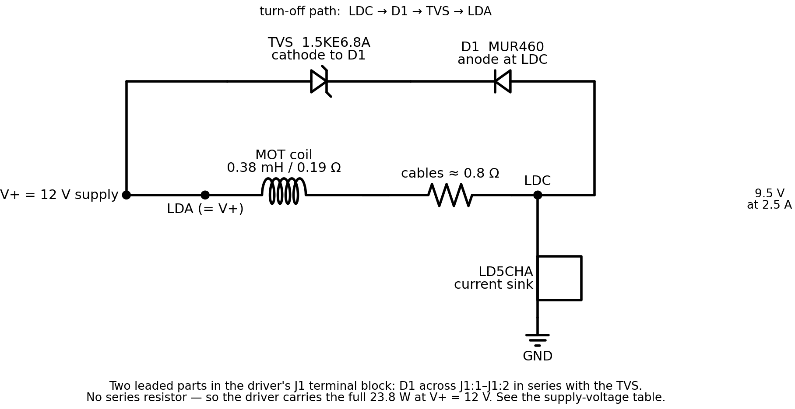

# LD driver protection circuit

Protecting a Wavelength **LD5CHA** laser-diode driver while it drives a **3D MOT coil**, and getting the fastest ramp-down that is safe for the driver.

**Load (confirmed):** L = 0.38 mH, coil R = 0.19 Ω, cables ≈ 0.8 Ω. Operating current 2.5 A.

**Final design:** D1 + 1.5KE10A TVS in series, cathode to cathode, across LDA–LDC. V+ = 12 V.
Ramp-down **96 µs** with I MON valid; clamp holds faults at 22.9 V.



---

## Start here

| | |
|---|---|
| ⭐ **[docs/design-summary.md](docs/design-summary.md)** | **The whole design in one document.** Read this first — everything below is supporting detail. |
| **[docs/final-design.md](docs/final-design.md)** | The chosen design in full detail, with every number derived |
| **[docs/order-list.md](docs/order-list.md)** | DigiKey BOM, spares, and the ordering traps |

## Repository layout

```
docs/                prose — the design and the reasoning behind it
  design-summary.md    ⭐ entry point: the whole design in one document
  final-design.md      the chosen design (D1 + TVS) in full detail
  order-list.md        BOM and ordering notes
  reference/           how the parts and instruments work (not design choices)
  analysis/            the ramp-speed / voltage / heat trade-offs
  alternatives/        designs that were considered and rejected, and why
figures/             all schematics and plots (generated by scripts/)
outputs/             captured script output, cited as evidence from the docs
scripts/             the Python that generates everything in figures/ and outputs/
archive/             superseded files kept only for history — see archive/README.md
```

### docs/reference — how things work

- [reference/tvs-diodes.md](docs/reference/tvs-diodes.md) — TVS diodes from first principles: operating regions, datasheet parameters, part numbering, selection procedure, failure modes
- [reference/clamp-sizing-and-imon.md](docs/reference/clamp-sizing-and-imon.md) — what the TVS does *in this circuit*, the I MON reference, and sizing the clamp so I MON stays valid
- [reference/coil-measurement.md](docs/reference/coil-measurement.md) — coil L and R derived from geometry by two methods, since confirmed on hardware
- [reference/driver-datasheet-check.md](docs/reference/driver-datasheet-check.md) — every LD5CHA spec verified against the Wavelength datasheet

### docs/analysis — the trade-offs

- [analysis/ramp-down-tradeoff.md](docs/analysis/ramp-down-tradeoff.md) — ramp-down timescale vs peak voltage and heat
- [analysis/ramp-speed-options.md](docs/analysis/ramp-speed-options.md) — every way to speed up the ramp, compared at a common LDC ceiling

### docs/alternatives — rejected, and why

- [alternatives/method-comparison.md](docs/alternatives/method-comparison.md) — the decision between the two candidate designs
- [alternatives/series-resistor.md](docs/alternatives/series-resistor.md) — method B: series 2 Ω + D1 + TVS
- [alternatives/unprotected-direct-drive.md](docs/alternatives/unprotected-direct-drive.md) — the original unprotected configuration, and why it needs a clamp

## Reproducing the figures

Needs **Python 3.9 or newer**:

```sh
python3 -m venv .venv && .venv/bin/pip install -r requirements.txt
.venv/bin/python scripts/<script>.py
```

`requirements.txt` lists minimum versions rather than exact pins, so pip resolves a release
with a prebuilt wheel for your interpreter. A clean install takes about a minute.

Run from the repository root — the scripts write to `figures/` and `outputs/` using paths
relative to it. Every figure and number in `docs/` is generated by a script in `scripts/`.

| Script | Produces |
|---|---|
| `coil_estimate.py` | `outputs/coil-estimate.txt` |
| `draw_d1_tvs_clamp.py` | `figures/schematic-d1-tvs-clamp.png`/`.svg` |
| `draw_series_resistor_clamp.py` | `figures/schematic-series-resistor-clamp.png`/`.svg` |
| `draw_direct_drive.py` | `figures/schematic-unprotected.png`/`.svg`, `figures/schematic-diode-only.png`/`.svg` |
| `imon_valid_sizing.py` | `outputs/imon-valid-sizing.txt` |
| `ramp_down_tradeoff.py` | `figures/ramp-down-tradeoff.png`, `outputs/ramp-down-table.md` |
| `ramp_speed_options.py` | `figures/ramp-speed-options.png` |
| `sim_direct_drive.py` | `figures/direct-drive-sim.png` |
| `sim_fastest_safe_ramp.py` | `figures/ramp-sim-d1-tvs.png`, `figures/ramp-sim-series-resistor.png` |
| `supply_voltage_window.py` | `figures/supply-voltage-window.png` |

Scripts whose output is a `.txt` print to stdout; the file in `outputs/` is a captured copy
so the docs can cite exact numbers without the reader having to run anything.
