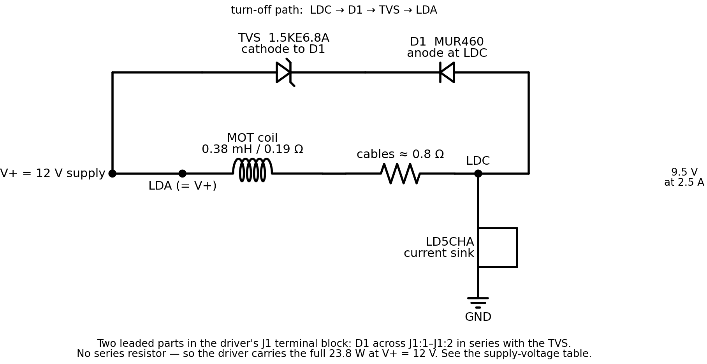

# Alternative: D1 + TVS only (no series resistor)

> **Read [imon-and-tvs.md](imon-and-tvs.md) first if you need I MON to read true current.** Once the clamp conducts, the coil current bypasses the driver and I MON reads ~0. That document resizes the clamp so it fires only on faults.

Sources: [draw_d1_zener.py](../scripts/draw_d1_zener.py) · [SVG](d1_zener.svg) · [computed output](d1_zener_output.txt)
Sibling of the [chosen design](chosen-design.md), which adds a series 2 Ω.
Load: L = 0.38 mH, coil R = 0.19 Ω, cables ≈ 0.8 Ω (confirmed). I = 2.5 A. R_loop = **0.99 Ω**, τ = **384 µs**.

## The circuit

Two leaded parts in the driver's J1 terminal block: **D1 in series with a TVS, cathode to cathode, across J1:2 (LDA) and J1:1 (LDC)**. Nothing else changes.

- **Normal operation:** LDA sits above LDC, so D1 is reverse-biased and the clamp carries nothing.
- **Turn-off:** step the setpoint to 0; current freewheels LDC → D1 → TVS → LDA.

This is the fastest you can get without a series switch — at any given ceiling on LDC, a constant-voltage clamp is the theoretical optimum ([why](ramp-speed-options.md)).

## Clamp choice

| Clamp part | V at 2.5 A (incl. D1) | Peak LDC at V+ = 12 V | t, 2.5 A → 10 % |
|---|---|---|---|
| none — D1 alone | 0.9 V | 12.9 V | 403 µs |
| **1.5KE6.8A** | **7.9 V** | **19.9 V** | **93 µs** |
| 1.5KE10A | 11.1 V | 23.1 V | 69 µs |
| 1.5KE15A | 16.2 V | 28.2 V | 49 µs |

Peak LDC is V+ plus the clamp voltage, so it falls if you lower V+ — at V+ = 8 V the 1.5KE6.8A peaks at 15.9 V instead of 19.9 V.

## The catch: supply voltage sets the driver's heat

Without Rs the whole load drop is only 2.48 V, so the driver absorbs the rest:

| V+ | LDC steady | Driver dissipation | % of the 25 W no-airflow limit | Ramp-up 0 → 2.5 A |
|---|---|---|---|---|
| 6 V | 3.52 V | 8.8 W | 35 % | 370 µs |
| **7 V** | **4.53 V** | **11.3 W** | **45 %** | 262 µs |
| **8 V** | **5.53 V** | **13.8 W** | **55 %** | 204 µs |
| 10 V | 7.53 V | 18.8 W | 75 % | 142 µs |
| 12 V | 9.53 V | 23.8 W | **95 %** | 109 µs |

At V+ = 12 V this design puts the driver at 95 % of its no-airflow rating with no margin for a warm room or a hot coil. Either add airflow (the rating rises to 35 W at 5.5 CFM) or drop the supply. **V+ = 8 V is the sensible default here**; V+ = 7 V reproduces the chosen design's 11.3 W exactly.

## How it compares to the series-2 Ω version

Both at 2.5 A with a 1.5KE6.8A clamp:

| | D1 + TVS, V+ = 7 V | D1 + TVS, V+ = 12 V | Series 2 Ω, V+ = 12 V |
|---|---|---|---|
| Parts | 2 leaded | 2 leaded | 3, one heatsinked |
| Ramp down to 10 % | 93 µs | 93 µs | **73 µs** |
| Ramp up 0 → 2.5 A | 262 µs | **109 µs** | 175 µs |
| Driver dissipation | 11.3 W | 23.8 W | 11.3 W |
| Heat elsewhere | none | none | 12.5 W in Rs |
| Peak LDC | **14.9 V** | 19.9 V | 19.9 V |

**What Rs actually buys you is ramp-up speed at low driver heat.** It drops LDC without dropping V+, so the driver stays cool *and* keeps headroom to push current into the coil. Lowering V+ instead gets you the same driver dissipation and a lower peak LDC, for free — but the ramp-up slows from 175 µs to 262 µs because the headroom goes away with the supply voltage.

So: if ramp-up speed matters, Rs earns its 12.5 W. If it does not, **D1 + TVS at V+ = 7–8 V is the better circuit** — fewer parts, no power resistor to mount, less total heat in the lab, and lower stress on LDC.

## Mounting — and one advantage over the Rs version

Peak LDC is identical wherever the clamp sits; only the loop resistance changes:

| Clamp position | Loop R | D1 alone | With 1.5KE6.8A |
|---|---|---|---|
| Driver terminals (cables in the loop) | 0.99 Ω | 403 µs | 93 µs |
| Coil terminals (cables outside the loop) | 0.19 Ω | 713 µs | 105 µs |

With a TVS fitted, mounting at the **coil** costs only 12 µs — and it means a broken cable on the driver side still leaves the coil a freewheel path. The series-2 Ω design cannot do this, because its clamp has to span Rs. If cable disconnection is a real risk in your setup, that is a genuine point in this design's favour.

## Parts

| Ref | Part | Why |
|---|---|---|
| D1 | MUR460 (4 A, 600 V ultrafast) — or 1N5408 (3 A, 1000 V) | Silicon, **not Schottky**: Schottky leakage runs to tens of mA hot and the driver reads it as load current, against its 0.5 mA stability |
| TVS | 1.5KE6.8A, unidirectional, axial | Flat clamp at 2.5 A. A 5 W zener's ~1.6 Ω dynamic resistance would add several unpredictable volts |
| — | Barrier terminal block | Both parts sit in it, cathode to cathode |

## What to expect, and bring-up

- **Ramp down:** about 93 µs to 10 %, LDC peaking at V+ + 7.9 V.
- **I MON reads ~0 during the decay**, because the current is in D1 rather than the driver. Use a current probe, not I MON, to measure the ramp.
- Set the LIM trimpot near 2.7 A. At V+ = 8 V the driver can reach 6.1 A into this load, so the limit matters.
- Start at 0.5 A, scope LDC with a **differential or isolated probe** (LDC is live — a scope ground clip shorts it), confirm the peak and the decay, then work up to 2.5 A and check case temperatures.
- Watch LDC for oscillation; the driver is compensated for a diode load, not an inductor.

## Caveats

- L and R are confirmed; everything downstream here is modelled, not measured.
- TVS breakdown has ±5 % tolerance (6.45–7.14 V), so peak LDC lands within about ±0.6 V of the figures above.
- D1's forward drop is taken as 0.95 V at 2.5 A.
- The datasheet gives **no maximum LDC voltage**, so where you set the clamp remains a judgement call.
