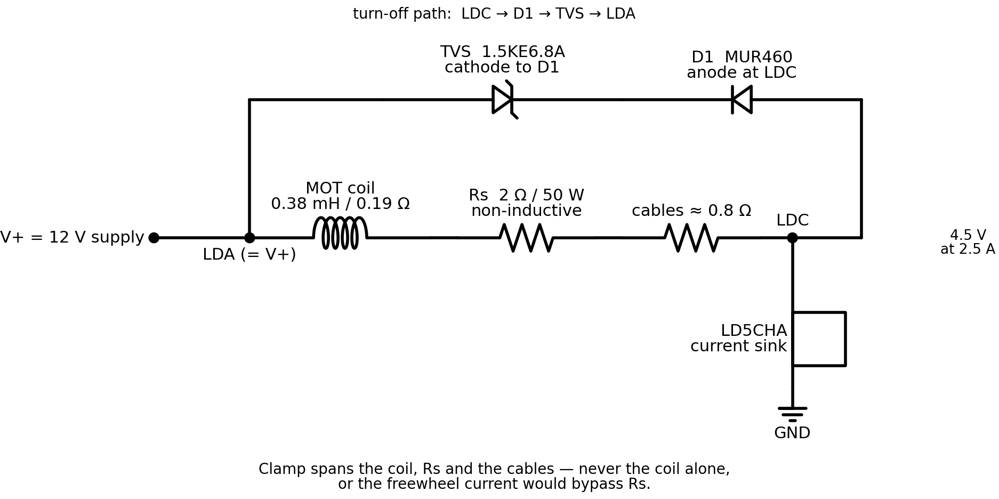
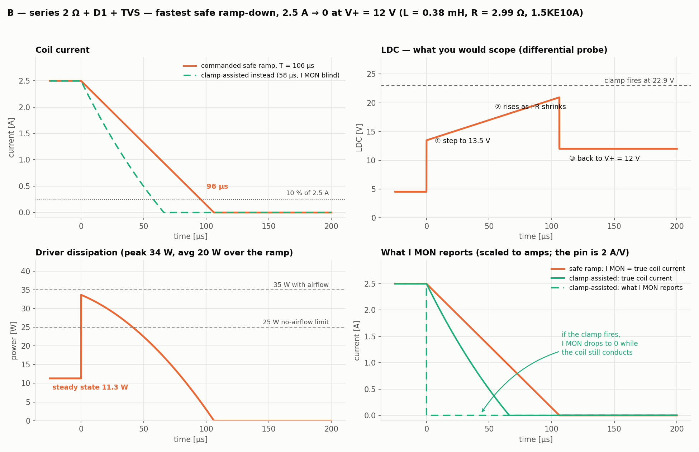

# Method B — series 2 Ω + D1 + TVS

Schematic source: [draw_series_resistor_clamp.py](../../scripts/draw_series_resistor_clamp.py) · [SVG](../../figures/schematic-series-resistor-clamp.svg) · [numbers](../../outputs/series-resistor-clamp.txt)
Simulation source: [sim_fastest_safe_ramp.py](../../scripts/sim_fastest_safe_ramp.py) · [output](../../outputs/fastest-safe-ramp.txt)
Background on the clamp and the monitor: [clamp-sizing-and-imon.md](../reference/clamp-sizing-and-imon.md). The other candidate: [method A](../final-design.md).

**Load (confirmed):** L = 0.38 mH, coil R = 0.19 Ω, cables ≈ 0.8 Ω. With Rs = 2 Ω → R_loop = **2.99 Ω**, τ = **127 µs**. V+ = 12 V, I = 2.5 A.

## The circuit

Rs goes in series with the coil. The clamp — D1 in series with a TVS, cathode to cathode — goes across **LDA to LDC**, spanning the coil, Rs and the cables together.

- **Normal operation:** LDA sits above LDC, so D1 is reverse-biased and the clamp carries nothing.
- **Turn-off:** current freewheels LDC → D1 → TVS → LDA.

**The clamp must not go across the coil alone.** During freewheel the node between coil and Rs sits above LDA, so a diode placed there would conduct, short the coil and bypass Rs entirely — removing the only thing Rs was added for.

## Why Rs forces V+ = 12 V

Rs drops 5 V at 2.5 A on top of the coil and cables, so the load takes 7.48 V in total. Compliance requires LDC ≥ 2 V, so V+ ≥ 9.5 V plus margin. That locks the supply near 12 V — **and every LDC excursion is then stacked on a 12 V rail instead of an 8 V one.**

| Quantity | Value | Note |
|---|---|---|
| Load drop I·R | 7.48 V | |
| LDC steady | **4.52 V** | 2.5 V above the 2 V compliance floor |
| Driver dissipation | **11.3 W** | 45 % of the 25 W no-airflow limit |
| Rs dissipation | **12.5 W** | Continuous — needs a genuinely heatsinked resistor |
| Cable / coil dissipation | 5.0 W / 1.2 W | |
| **Total heat in the system** | **30.0 W** | Against 20.0 W for [method A](../final-design.md) |

## Fastest safe ramp-down

Same definition of safe: the driver stays in regulation, the clamp never conducts, I MON stays valid. The usable overshoot is set by the TVS standoff, not by the circuit:

> ΔV = 8.55 + 0.4 = **8.95 V** → commanded linear ramp T = L·I₀/ΔV = **106 µs** → **96 µs to 10 %**

| Quantity | Value |
|---|---|
| Ramp-down to 10 % | **96 µs**, I MON valid throughout |
| LDC: steady → step → peak → settle | 4.52 V → 13.5 V → **21.0 V** → 12 V |
| Clamp fires at | 22.9 V (faults only) |
| Driver power during the ramp | peak 34 W, average 20 W |
| Ramp-up 0 → 2.5 A | **175 µs** |
| If you let the clamp do it instead | 58 µs, but I MON goes blind |

### Rs buys no ramp-down speed

Peak LDC during a commanded linear ramp is V+ + L·I₀/T, and that peak occurs at the **end**, where i → 0 and the i·R term has vanished. **R does not appear, so the ramp-down is 96 µs with or without Rs.** Rs only speeds the clamp-assisted case (58 µs vs 70 µs), which is exactly the mode you cannot use if I MON must stay valid.

What Rs does buy:
- **Ramp-up: 175 µs vs 204 µs.** It drops LDC without dropping V+, so the driver keeps headroom to push current into the coil. This is the one real advantage.
- **2.5 W less in the driver** (11.3 W vs 13.8 W) — but at the cost of 12.5 W elsewhere, and method A reaches the same 11.3 W simply by running at V+ = 7 V.

### What you would observe

**Coil current** — a straight line, 2.5 A → 0 over 106 µs, crossing 10 % at 96 µs. Identical to method A.

**LDC** — the same three features, but shifted up and with a steeper middle section, because the i·R term it loses is 7.48 V rather than 2.48 V:
1. a **step up to 13.5 V** at t = 0;
2. a **steeper linear rise to 21.0 V**;
3. a **step back down to V+ = 12 V**.

**I MON** — tracks the coil exactly, 1.25 V → 0 V at 2 A/V.

**Driver dissipation** — 34 W peak, decaying to zero, averaging 20 W over the ramp.

## Parts

| Ref | Part | Why |
|---|---|---|
| Rs | 2 Ω, 50 W aluminium-housed power resistor, **bolted to a heatsink or chassis plate** | 12.5 W continuous. Unheatsinked, a "50 W" part is good for only 10–15 W. Non-inductive preferred; a plain wirewound adds a few µH, under 1 % of 0.38 mH |
| D1 | MUR460 (4 A, 600 V ultrafast) — or 1N5408 | Silicon, **not Schottky** — Schottky leakage would bypass the coil |
| TVS | **1.5KE10A**, unidirectional, axial | 8.55 V standoff sets the usable ramp. See [clamp-sizing-and-imon.md](../reference/clamp-sizing-and-imon.md) |
| — | Barrier terminal block | D1 + TVS across J1:1–J1:2 |

## Mounting

Put D1 and the TVS in the terminal block **at the driver**, across J1:2 and J1:1 — the clamp has to span LDA–LDC anyway. Rs can then live wherever its heat is convenient.

The trade-off: a cable break between driver and coil leaves the coil without a freewheel path. With only 1.19 mJ stored that is a small arc rather than a hazard, but use locking connectors and never unplug under current. Mounting Rs **and** the clamp together at the coil end restores the protection, at the cost of 12.5 W of heat near the chamber. Unlike [method A](../final-design.md), you cannot simply move the clamp alone.

## Bring-up

1. Set the LIM trimpot to ~2.7 A. At V+ = 12 V the driver can reach only 3.34 A into this load, so there is less margin than in method A.
2. Drive MOD INPUT (1 A/V) with a linear 2.5 V → 0 V ramp over 106 µs.
3. Start at 0.5 A. Scope LDC with a **differential or isolated probe**.
4. Confirm steady LDC ≈ 4.5 V at 2.5 A and the three-feature waveform.
5. **Shorten the ramp until the clamp fires**, then back off ~20 %. LDC flat-tops at 22.9 V and I MON collapses to ~0 while current still flows.
6. Check case temperature of **both** the driver and Rs after a few minutes at 2.5 A.

## Caveats

- L and R are confirmed; everything downstream is modelled.
- Compliance margin is only 2.5 V, so a hot coil or a sagging supply eats into it faster than in method A.
- TVS tolerance ±5 % shifts the usable ΔV and the clamp threshold — hence step 5.
- The LD5CHA datasheet gives **no maximum LDC voltage**; 21 V peak is a judgement call below the 28 V maximum compliance figure, and 4 V higher than method A for the same ramp.
