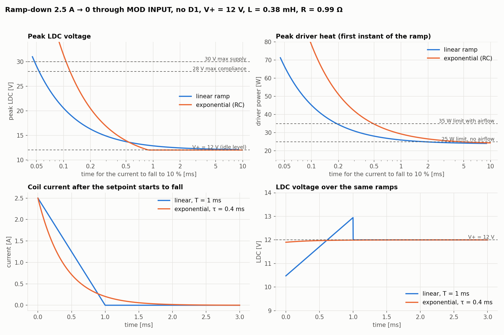

# Ramp-down 2.5 A → 0 through MOD INPUT (original config, no D1, V+ = 12 V)

Script: [ramp_down_tradeoff.py](../../scripts/ramp_down_tradeoff.py). Tables: [ramp-down-table.md](../../outputs/ramp-down-table.md).

## Model
The setpoint on MOD INPUT (1 A/V, so 2.5 V → 0 V) is ramped and the driver is assumed to track it (its rise or fall time is about 0.8 µs, far faster than these ramps). Values: L = 0.38 mH, R = 0.99 Ω (coil plus cables), V+ = 12 V, I0 = 2.5 A.

| Setpoint shape | Current | LDC voltage | Where LDC peaks |
|---|---|---|---|
| Linear, time T | i = I0·(1 − t/T) | V+ − i·R + L·I0/T | End of the ramp, at V+ + L·I0/T |
| Exponential (RC), time constant τ | i = I0·e^(−t/τ) | V+ − i·(R − L/τ) | Start of the ramp. **Never above V+ when τ ≥ L/R = 0.38 ms.** |

Driver heat is P = LDC·i.

## Results
**Linear ramp**

| Ramp time T | Peak LDC | Driver peak P | Time to 10 % | Verdict |
|---|---|---|---|---|
| 0.05 ms | 31.0 V | 71 W | 0.05 ms | avalanche risk (above 30 V) |
| 0.1 ms | 21.5 V | 48 W | 0.09 ms | high, unverified |
| 0.2 ms | 16.8 V | 36 W | 0.18 ms | moderate |
| 0.5 ms | 13.9 V | 29 W | 0.45 ms | benign |
| 1 ms | 12.9 V | 26 W | 0.9 ms | benign |
| 2 ms | 12.5 V | 25 W | 1.8 ms | benign |
| 5 ms | 12.2 V | 24 W | 4.5 ms | benign |
| 10 ms | 12.1 V | 24 W | 9 ms | benign |

**Exponential (RC) ramp**

| τ | Peak LDC | Driver peak P | Time to 10 % | Time to 1 % | Verdict |
|---|---|---|---|---|---|
| 0.05 ms | 28.5 V | 71 W | 0.12 ms | 0.23 ms | high, unverified |
| 0.1 ms | 19.0 V | 48 W | 0.23 ms | 0.46 ms | high, unverified |
| 0.2 ms | 14.3 V | 36 W | 0.46 ms | 0.92 ms | moderate |
| 0.3 ms | 12.7 V | 32 W | 0.69 ms | 1.38 ms | benign |
| 0.4 ms | 12.0 V | 30 W | 0.92 ms | 1.84 ms | benign, no overshoot above V+ |
| 0.5 ms | 12.0 V | 29 W | 1.15 ms | 2.3 ms | benign, no overshoot above V+ |
| 1 ms | 12.0 V | 26 W | 2.3 ms | 4.61 ms | benign, no overshoot above V+ |
| 2 ms | 12.0 V | 25 W | 4.61 ms | 9.21 ms | benign, no overshoot above V+ |

Steady 2.5 A dissipation 23.8 W. The exponential has no overshoot above V+ when τ ≥ L/R = 0.38 ms. Stored coil energy ½·L·I0² = 1.19 mJ.

## What the plots show
- **Peak LDC voltage** (top left). The x axis is the time for the current to fall to 10 %, so the two shapes are compared at the same speed.
  - Below about 0.55 ms the exponential is the worse one. Its peak is at the very start, where the current is largest. For example, τ = 0.1 ms (0.23 ms to 10 %) gives 19 V and τ = 0.05 ms gives 28.5 V.
  - Above about 0.55 ms the exponential wins. It stays at or below V+ (12 V), while the linear ramp still overshoots by L·I0/T (for example +0.95 V at 1 ms).
- **Heat** (top right). Peak driver power is reached in the first instant. A linear 1 ms ramp starts at 26 W. An exponential with τ = 0.4 ms starts at 30 W, because LDC jumps from 9.5 V to about 11.9 V when the ramp begins. Both last microseconds, and both stay under the 35 W airflow limit. Below about 0.2 ms the peak exceeds 35 W. The coil's own stored energy is only 1.19 mJ (about 50 µs of steady heating), whatever the shape.
- **Waveforms** (bottom). A linear 1 ms ramp and an exponential with τ = 0.4 ms fall to 10 % in about the same time (0.9 ms). The exponential never goes above 12 V. The linear ramp climbs to 12.95 V, then LDC returns to V+ when the current reaches zero.

## Recommendation for the bare connection
1. **Preferred: exponential RC with τ ≈ 0.4–0.5 ms.** It falls to 10 % in about 1 ms, and LDC never exceeds V+.
2. **Alternative: linear ramp of 1 ms or longer**, from a function generator, with about 1 V of overshoot above V+.
3. **Avoid ramps whose time to 10 % is below 0.2 ms.** The peak LDC is above 17 V and the peak power is above 35 W.
4. **Ramp-down with abrupt interruption** (an uncommanded cut) is different. It is not covered by the model and is the case D1 is meant for.

RC implementation note: the MOD pin has 2.5 kΩ input impedance, so use a source resistor much smaller than 2.5 kΩ (for example 100 Ω with 4 µF for τ = 0.4 ms, about 4 % gain error). I'm assuming the pin acts as a plain resistor into a summing node, so verify on the bench. Keep the MOD pin between −2 V and +5 V.

## Caveats
- A model, not a measurement. It assumes the loop tracks the setpoint and that R is constant.
- The datasheet gives no maximum LDC voltage. The 28 V and 30 V lines are the compliance and supply limits, used as reference points.
- Verify on the bench using the I MON output (2 A/V on the LD5CHA) for current and a differential or isolated probe on LDC. Start at 0.5 A and shorten the ramp step by step.
