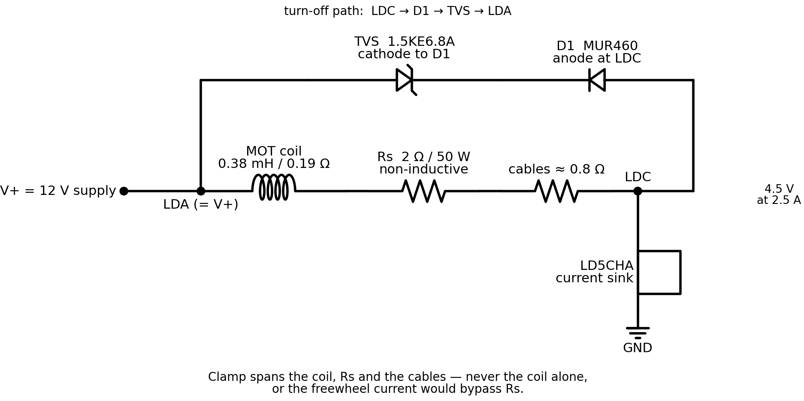

# Chosen design: series 2 Ω + D1 + TVS clamp

Sources: [draw_series_r_clamp.py](../scripts/draw_series_r_clamp.py) · [SVG](series_r_clamp.svg) · [computed output](series_r_clamp_output.txt)
Load: L = 0.38 mH, coil R = 0.19 Ω, cables ≈ 0.8 Ω (confirmed). V+ = 12 V, I = 2.5 A.

## How it works

Rs goes in series with the coil, and the clamp (D1 in series with a TVS, cathode to cathode) goes across **LDA to LDC** — that is, across the coil, Rs and the cables together.

- **Normal operation.** LDA sits above LDC, which reverse-biases D1, so the clamp carries nothing and does not disturb the measured coil current. The TVS is forward-biased but D1 is what blocks.
- **Turn-off.** Step the MOD INPUT setpoint to 0. The driver's pass transistor stops sinking, LDC rises until the clamp conducts, and the current freewheels **LDC → D1 → TVS → LDA**, decaying against the TVS voltage plus i·R_total.

The clamp must **not** go across the coil alone. During freewheel the node between coil and Rs sits above LDA, so a diode there would conduct, short the coil and bypass Rs entirely.

## Operating point at 2.5 A

R_total = 0.19 + 0.80 + 2.0 = **2.99 Ω**, τ = L/R = **127 µs**.

| Quantity | Value | Note |
|---|---|---|
| Load drop I·R | 7.48 V | |
| **LDC steady** | **4.52 V** | Compliance floor is 2 V → **2.5 V of margin** |
| **Driver dissipation** | **11.3 W** | Was 23.8 W without Rs. Now comfortably under the 25 W no-airflow limit |
| Rs dissipation | 12.5 W | Continuous — needs a real heatsinked power resistor |
| Cable dissipation | 5.0 W | Spread along the cable |
| Coil dissipation | 1.2 W | |
| Stored energy ½·L·I² | 1.19 mJ | What the clamp absorbs per shot |

**The thermal relief is the main prize here.** Moving 12.5 W out of the LD5CHA and into a resistor you can bolt anywhere takes the driver from 95 % of its no-airflow rating down to 45 %. The speed gain is the secondary benefit.

## Choosing the TVS

| Clamp part | V at 2.5 A (incl. D1) | Peak LDC | t, 2.5 A → 10 % |
|---|---|---|---|
| none — D1 alone | 0.9 V | 12.9 V | 204 µs |
| **1.5KE6.8A** | **7.9 V** | **19.9 V** | **73 µs** |
| 1.5KE10A | 11.1 V | 23.1 V | 57 µs |
| 1.5KE15A | 16.2 V | 28.2 V | 42 µs |

**Recommended: 1.5KE6.8A** → about 73 µs with LDC peaking near 20 V. Note this lands at ~20 V, not the 18 V used in the earlier comparison — standard TVS voltages do not fall exactly on 18 V. If 20 V is more than you want to put on LDC, fit D1 alone first (12.9 V, 204 µs) and add the TVS later; the wiring is identical.

**Use a TVS, not a small zener.** A 5 W zener such as the 1N5338B is specified at a couple of hundred mA; at 2.5 A its dynamic resistance (~1.6 Ω) adds several volts of poorly-controlled drop. A 1.5KE part is specified at over 100 A, so at 2.5 A it clamps essentially at its breakdown voltage.

Energy per shot into the TVS is well under 1 mJ, so even at 100 Hz it dissipates tens of mW against a 1500 W pulse rating. The TVS is oversized on purpose — it is chosen for its flat clamp, not its energy.

## Parts

| Ref | Part | Why |
|---|---|---|
| Rs | 2 Ω, 50 W aluminium-housed power resistor, **bolted to a heatsink or chassis plate** | 12.5 W continuous. Unheatsinked, a "50 W" part is good for only 10–15 W. Non-inductive (Ayrton-Perry or thick-film) preferred; a plain wirewound adds a few µH, under 1 % of 0.38 mH, which is tolerable |
| D1 | MUR460 (4 A, 600 V ultrafast) — or 1N5408 (3 A, 1000 V) | Silicon, **not Schottky**: Schottky leakage is tens of mA when hot and the driver would read it as load current, swamping its 200 ppm (0.5 mA) stability. Only sees ~7 V reverse here |
| TVS | 1.5KE6.8A, unidirectional, axial | Sets the clamp voltage, flat at 2.5 A |
| — | Barrier or DIN terminal block | Mount D1 + TVS directly across driver terminals J1:2 (LDA) and J1:1 (LDC) |

## Mounting

Put D1 and the TVS in the terminal block **at the driver**, across J1:2 and J1:1, since the clamp has to span LDA–LDC anyway. Rs can then live wherever its heat is convenient.

The trade-off: a cable break between driver and coil leaves the coil with no freewheel path. With only 1.19 mJ stored that is a small arc rather than a hazard, but use locking connectors and never unplug under current. If cable disconnection is a real operational risk, mount Rs **and** the clamp together as one assembly at the coil end instead — then a driver-side break still has a loop, at the cost of 12.5 W of heat near the chamber.

## What to expect

- **Ramp down:** step the setpoint to 0 → about **73 µs** to 10 %, LDC peaking near 20 V.
- **Ramp up:** 0 → 2.5 A in about **175 µs** (was 109 µs without Rs — Rs costs headroom, so this direction gets slower). The driver can reach 3.34 A into this load, so set the LIM trimpot near 2.7 A.
- **Diagnostics gotcha:** during the clamp phase the current flows through D1, not through the driver, so **I MON reads ~0 while the coil is still carrying current**. Do not use I MON to measure the decay — use a current probe or a sense resistor.

## Bring-up

1. Set the LIM trimpot to about 2.7 A before connecting the coil.
2. Start at 0.5 A. Confirm LDC ≈ 10.5 V steady (12 − 0.5 × 2.99).
3. Scope LDC with a **differential or isolated probe** — LDC is a live node, and clipping a scope ground to it shorts it to ground.
4. Step the setpoint to 0 and confirm LDC peaks near 20 V and the current decays in roughly 75 µs.
5. Work up to 2.5 A, then check the case temperature of both the driver and Rs after a few minutes.
6. Watch LDC for oscillation — the driver is compensated for a diode load, not an inductor.

## Caveats

- L and R are confirmed; everything downstream of them here is modelled, not measured.
- The TVS breakdown has a ±5 % tolerance (6.45–7.14 V for the 1.5KE6.8A), so peak LDC lands somewhere in 19.4–20.6 V.
- D1's forward drop is taken as 0.95 V at 2.5 A.
- The datasheet still gives **no maximum LDC voltage**. 20 V is a judgement call, below the 28 V maximum compliance figure but not sanctioned by anything published.
