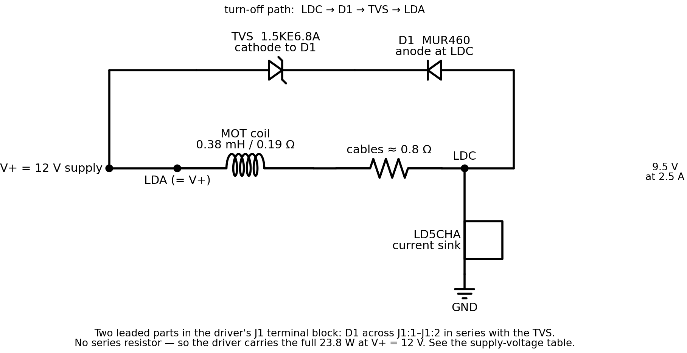
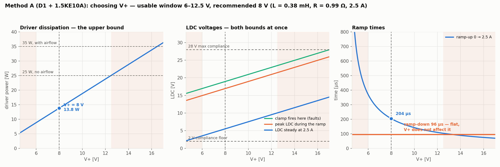
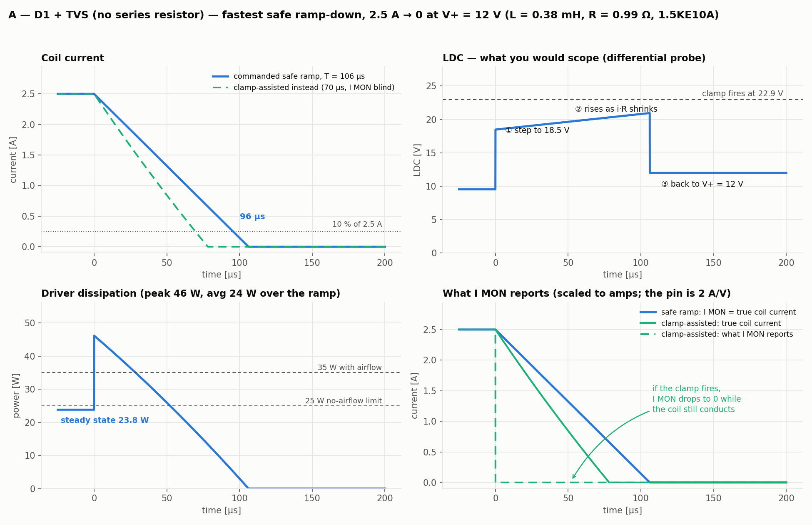
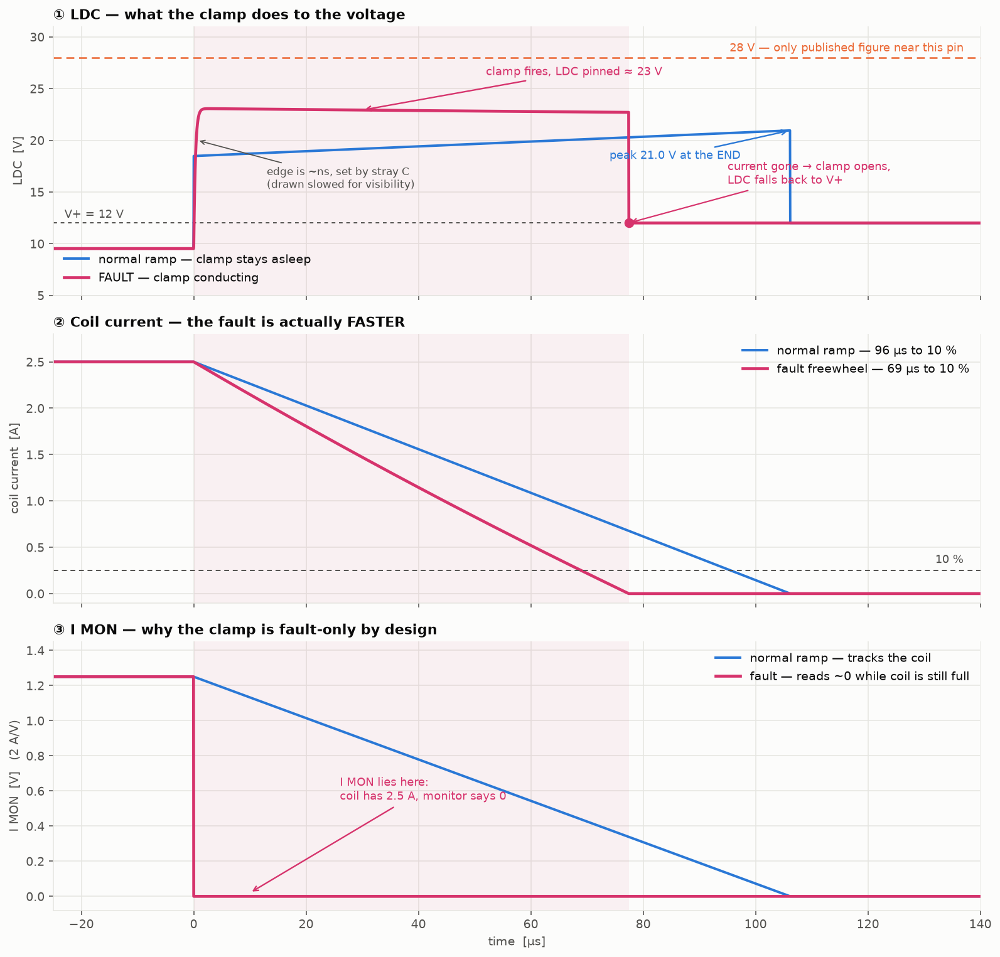

# MOT coil driver — final design summary

Driving a **3D MOT magnetic coil** from a Wavelength **LD5CHA** laser-diode driver, with
inductive-kick protection and the fastest ramp-down the driver can survive while its
current monitor stays valid.

This is the single-document version of the whole design. Every number here is derived in
one of the linked docs, and every figure is generated by a script in [`scripts/`](../scripts/).

---

## 1. The problem in one paragraph

The LD5CHA is a **low-side current sink** built for laser diodes. LDA is tied internally to
V+; the load sits between LDA and LDC, and the driver pulls LDC down to whatever voltage
makes the current correct. A laser diode is resistive, so the datasheet never discusses
inductive loads, documents **no output clamp or flyback diode**, and gives **no maximum
voltage for the LDC pin**. Drive a 0.38 mH coil with it and every current change pushes
LDC the *wrong* way — up, toward and past V+. Interrupt the current abruptly and LDC flies
until something breaks down. The job is to bound that excursion, and then to ramp as fast
as that bound allows.

## 2. The load (confirmed on hardware)

| Quantity | Value |
|---|---|
| Inductance **L** | **0.38 mH** |
| Coil resistance | 0.19 Ω |
| Cable + connection resistance | ≈ 0.8 Ω |
| **Loop resistance R** | **0.99 Ω** |
| Electrical time constant τ = L/R | **384 µs** |
| Operating current I₀ | **2.5 A** |
| Voltage across the load at I₀ | 2.48 V |
| Stored energy ½LI₀² | **1.19 mJ** |

L and R were first derived from the winding geometry (ID 30 mm → OD 60 mm, 15 mm build,
100 turns of 16 AWG) by two independent methods that agreed within 2 %, then confirmed on
the hardware. See [coil-measurement.md](reference/coil-measurement.md).

**The stored energy is tiny.** 1.19 mJ is not a destructive amount of energy — it is a
destructive amount of *voltage* if delivered into a high impedance. That distinction is
what makes this a clamp problem rather than an energy-absorption problem, and it is why the
100 V MOSFET switch from the earlier design history is unnecessary here.

## 3. The driver's limits

Verified against the [LDxCHA datasheet](https://www.teamwavelength.com/download/Datasheets/LD15CHA.pdf) — see [driver-datasheet-check.md](reference/driver-datasheet-check.md).

| Spec | Value |
|---|---|
| Max output current | 5 A |
| Supply V+ | 5–30 V |
| Compliance | always **2 V below V+** |
| Max internal dissipation | **25 W** no airflow · **35 W** with 5.5 CFM (both at 25 °C) |
| Operating temperature | 0–40 °C |
| MOD INPUT (CC mode) | 1 A/V, −2 to +5 V, 2.5 kΩ; damage at ≤ −3 V or ≥ +8 V |
| I MON | 2 A/V on J3:2, ±0.64 % FS (±32 mA) |
| **Max LDC voltage** | **not specified** |
| **Internal output clamp** | **none documented** |

Two of these shape everything: the **25 W** dissipation limit sets how high V+ can go, and
the **unspecified LDC maximum** means every clamp voltage in this design is a judgement
call rather than a spec compliance check. The only published figure anywhere near it is the
28 V compliance at a 30 V supply, which is what the clamp is kept below.

## 4. The governing physics

Three results drive every choice made here.

**(a) Ramp time is voltage divided into flux.** The coil only sheds current when LDC rises
above V+. With ΔV volts of allowed overshoot,

> **t ≈ L·I₀ / ΔV = 0.95 mV·s / ΔV**

Every microsecond of ramp-down has to be bought with volts on an unrated pin. That is the
entire trade in one line.

**(b) A constant-voltage clamp is the fastest possible trajectory.** Under a ceiling
LDC ≤ V_max, the optimum holds LDC *at* the ceiling for the whole ramp — which is exactly
what a clamp does:

> t(i_f) = (L/R)·ln((I₀R + ΔV)/(i_f·R + ΔV))

No setpoint shape can beat it; a linear ramp saves its voltage budget for the end, an
exponential spends it at the start, and the clamp spends it throughout. See
[ramp-speed-options.md](analysis/ramp-speed-options.md).

**(c) A series resistor buys no ramp-down speed.** For a commanded linear ramp in
regulation, LDC(t) = V+ − i·R + L·I₀/T, which peaks at the **end**, where i → 0 and the i·R
term has vanished. **R drops out of the peak.** Adding series resistance makes the driver
cooler and the ramp no faster. This is the single most useful result in the project,
because it eliminated an entire branch of the design space.

## 5. The design

**Two leaded parts in the driver's J1 terminal block: D1 in series with a TVS, cathode to
cathode, across J1:2 (LDA) and J1:1 (LDC).** Nothing else in the circuit changes.

- **Normal operation** — LDA sits 2.48 V above LDC, so D1 is reverse-biased and the clamp
  is electrically invisible. No leakage path parallels the coil.
- **Ramping** — LDC rises above V+. As long as it stays below the clamp, the driver remains
  in regulation and **I MON reads true coil current**.
- **Fault** — if LDC ever reaches the clamp (a disconnected coil, an ENABLE drop, a
  commanded ramp that is too fast), current freewheels LDC → D1 → TVS → LDA and the
  excursion stops at 22.9 V.

**Why two parts and not one.** A bare diode clamps at 0.7 V, which would make the ramp-down
403 µs — safe but slow. A bare TVS cannot be used alone because it would conduct in the
wrong direction in normal operation. In series, **D1 provides the blocking and the TVS sets
the clamp level.** This is the key structural idea of the design.

### Operating point: V+ = 12 V

| | Value |
|---|---|
| LDC, steady at 2.5 A | **9.53 V** (7.53 V of compliance margin) |
| Driver dissipation, steady | **23.8 W — 95 % of the 25 W no-airflow rating** |
| Peak LDC during the working ramp | **21.0 V** |
| Clamp threshold | **22.9 V** (faults only) |
| Headroom clamp → 28 V | 5.1 V |

Three bounds close in from both sides, and **12 V sits at the top of the usable window**:

- **Lower — compliance.** LDC must stay above 2 V. The hard floor is V+ ≥ 4.47 V; below
  ~6 V a warm coil or a sagging supply pushes the driver out of regulation.
- **Upper — heat.** The driver reaches 25 W at 12.5 V and 35 W at 16.5 V.
- **Upper — LDC stress.** Every excursion stacks on V+, so the clamp threshold rises with
  the rail. At 16 V it would sit at 26.9 V, within sight of 28 V.

**V+ buys ramp-up speed only.** Ramp-*down* is 96 µs at every supply voltage, because it is
set by the TVS standoff and L·I₀ rather than by the rail. 12 V was chosen for the 109 µs
ramp-up — nearly twice as fast as 8 V — and the cost is thermal margin.

### Where the heat goes — and why that is fixed

Total dissipation is **exactly V+ · I₀ = 30.0 W**, no matter what the circuit looks like.
R_loop only decides how it splits:

| | Driver | Coil | Cables | Series R | Total |
|---|---|---|---|---|---|
| **This design, 12 V** | **23.8 W** | 1.19 W | 5.00 W | — | 30.0 W |
| Same design, 8 V | 13.8 W | 1.19 W | 5.00 W | — | 20.0 W |
| With a 2 Ω series resistor, 12 V | 11.3 W | 1.19 W | 5.00 W | 12.5 W | 30.0 W |

Two consequences that are easy to get backwards:

- **The 0.8 Ω of cable resistance is acting as useful ballast.** It absorbs 5 W and 2 V that
  would otherwise land in the driver. *Shortening or thickening the cables would make the
  driver hotter, not cooler*, unless V+ comes down with it.
- **The only way to reduce total heat is to lower V+.** A series resistor relocates heat; it
  does not remove it.

### Parts

| Ref | Part | Why this one |
|---|---|---|
| **TVS** | **1.5KE10A**, unidirectional, axial DO-201 | 8.55 V standoff sets the 96 µs working ramp; 10 V breakdown gives a flat clamp at 2.5 A |
| **D1** | **MUR460** (4 A / 600 V ultrafast) — or 1N5408 | **Silicon, not Schottky.** Schottky leakage reaches tens of mA when hot, in parallel with the coil, so the coil would get measurably less current than the driver regulates. Reverse voltage here is only I₀·R ≈ 2.5 V, so the 600 V rating is overkill |
| — | 6-position barrier terminal block (Cinch 6-141) | Holds both parts cathode-to-cathode across J1:1–J1:2 |
| **Fan** | 40 mm 12 V DC axial, ≥ 6 CFM | **Required at 12 V.** 5.5 CFM moves the limit from 25 W to 35 W, taking the driver from 95 % to 68 %. Runs off the same rail |

Full ordering detail, including the bidirectional-part trap: [order-list.md](order-list.md).

### Mounting

Peak LDC is identical wherever the clamp sits; only the freewheel loop resistance changes.

| Clamp position | Loop R | Fault decay, with TVS |
|---|---|---|
| Driver terminals (cables inside the loop) | 0.99 Ω | 93 µs |
| **Coil terminals (cables outside)** | 0.19 Ω | 105 µs |

Mounting at the **coil** costs ~12 µs in the fault case and means a broken cable on the
driver side still leaves the coil a freewheel path. This design can make that choice; one
with a series resistor cannot, because its clamp has to span the resistor.

## 6. Performance

"Safe" means the driver stays in regulation the whole way down, so the clamp never conducts
and **I MON keeps reading true coil current**. That caps the overshoot at the TVS standoff:

> ΔV = V_wm + V_f = 8.55 + 0.4 = **8.95 V** → commanded linear ramp T = L·I₀/ΔV = **106 µs**
> → **96 µs to 10 %**

| Quantity | Value |
|---|---|
| **Ramp-down to 10 %** | **96 µs**, I MON valid throughout |
| Ramp-up 0 → 2.5 A | 109 µs |
| LDC: steady → step → peak → settle | 9.53 V → 18.5 V → **21.0 V** → 12 V |
| Driver power during the ramp | peak 46 W, average 24 W, for ~106 µs (**2.5 mJ**) |
| If the clamp does the ramp instead | 70 µs, but I MON goes blind |

**What a scope would show.** Coil current: a straight line, 2.5 A → 0 over 106 µs. LDC: a
~9 V step at t = 0, then a *linear rise* to 21.0 V as the i·R term shrinks, then a step back
to V+. I MON: tracks the coil exactly, 1.25 V → 0 at 2 A/V. Corners are idealised — the
driver's loop is ~0.8 µs, so expect rounding and possibly slight ringing at each step.

**The 46 W transient is not the thermal problem.** It lasts 106 µs and totals 2.5 mJ, which
the package absorbs without noticing. **The 23.8 W steady state is the problem** — hence the
fan.

## 7. The I MON constraint — why the ramp is 96 µs and not 70 µs

This is the design decision most likely to be misread later, so it is worth stating plainly.

**I MON measures driver current, not coil current.** The two are the same only while all the
current flows through the driver. The moment the clamp conducts, the coil's current
freewheels through D1 and the TVS, bypassing the driver entirely — so **I MON collapses to
~0 while the coil is still fully energised.** The bottom-right panel of the figure above
shows exactly this.

A clamp-assisted decay would be faster (70 µs vs 96 µs). It was rejected because the
experiment needs a valid current readback. The resolution: **size the clamp above the
working ramp**, so the driver stays in regulation and the clamp becomes fault-only
protection. The cost of a trustworthy monitor is 26 µs.

Simulated by [sim_fault_clamp.py](../scripts/sim_fault_clamp.py) · [output](../outputs/fault-clamp.txt). Blue is the normal ramp, magenta a fault: LDC steps
straight to a 23 V flat top while I MON collapses to zero with the coil still energised.
**Both traces changing at once is the signature to look for during bring-up** (§8 step 5).

Detail, including the TVS's three operating regions: [clamp-sizing-and-imon.md](reference/clamp-sizing-and-imon.md).

## 8. Bring-up

1. **Set the LIM trimpot to ~2.7 A before connecting the coil.** At 12 V this load would
   accept about 10 A — double the driver's 5 A maximum — so LIM is the only limit that
   applies. Fit the heatsink and the fan in the same step.
2. Drive MOD INPUT (1 A/V in CC mode) with a linear 2.5 V → 0 V ramp over 106 µs. Keep the
   pin inside −2 V to +5 V.
3. Start at **0.5 A with a slow ramp**. Scope LDC with a **differential or isolated probe** —
   LDC is live, and a scope ground clip shorts it to ground.
4. Confirm steady LDC ≈ 9.5 V at 2.5 A, and the three-feature LDC waveform above.
5. **Shorten the ramp until the clamp fires, then back off ~20 %.** The signature appears on
   two traces at once: LDC flat-tops at 22.9 V instead of continuing to rise, and I MON
   collapses to ~0 while current still flows. **That measured threshold supersedes the
   calculated 106 µs**, because it includes tolerances the model does not know.
6. **Check case temperature after a few minutes at 2.5 A.** This matters more at 12 V than
   any other step. If the case is too hot to hold comfortably, add airflow or drop V+ to
   10 V.

## 9. What was rejected, and why

| Option | Best ramp-down | Why not |
|---|---|---|
| **Nothing** (as originally wired) | — | LDC excursion unbounded; the driver's output stage is the only thing stopping it. See [unprotected-direct-drive.md](alternatives/unprotected-direct-drive.md) |
| **D1 alone** (1N5408 across the load) | 403 µs | Safe and nearly free, but it clamps at its own forward drop (0.95 V at 2.5 A), so the decay is essentially L/R. Fine if 0.4 ms is acceptable |
| **Series 2 Ω + D1 + TVS** | 96 µs | **Identical ramp-down** at the same rail — result (c) in §4. Moves 12.5 W out of the driver, but costs 66 µs of ramp-up, 5 V of compliance margin, a 50 W heatsinked resistor, and the ability to mount the clamp at the coil. A fan achieves the same thermal result more simply. [Full writeup](alternatives/series-resistor.md) |
| **Clamp-assisted decay** | 70 µs | I MON goes blind — §7 |
| **Series MOSFET + 100 V TVS** | 8 µs | 80× more inductance was assumed when this was proposed. At 0.38 mH and 1.19 mJ it is a large amount of complexity, isolated gate drive and failure modes for a ramp that two leaded parts already deliver. Also note I MON is blind here too — the driver is switched out of the loop |
| **Fewer turns at higher current** (half the turns, 5 A) | 38 µs | Requires rewinding the coil, and 5 A is the driver's absolute maximum — no headroom left |

The full comparison at a common LDC ceiling is in [ramp-speed-options.md](analysis/ramp-speed-options.md);
the A-vs-B decision is in [method-comparison.md](alternatives/method-comparison.md).

## 10. Known unknowns

These are honest gaps, not hedges — each one is a place where the design rests on judgement
or on a model rather than a measurement.

- **No published maximum LDC voltage.** The 22.9 V clamp is a judgement call below the 28 V
  compliance figure. If Wavelength will state a real limit, ask them — it is the single
  piece of information that would most improve this design.
- **L and R are confirmed; everything downstream is modelled.** The waveforms in §6 come
  from an analytic model, not a bench measurement or a SPICE run. Step 5 of bring-up exists
  precisely because the model's 106 µs should not be trusted over a measurement.
- **TVS tolerance is ±5 %**, so both the usable ΔV and the clamp threshold move with the
  individual part.
- **D1's forward drop** is taken as 0.4 V at leakage currents and 0.95 V at 2.5 A.
- **Eddy currents are not modelled.** In a metal vacuum chamber, the *field* may decay far
  more slowly than the current, and nothing in this circuit can change that. If the
  experiment cares about field decay rather than current decay, that is the next thing to
  measure — and it may make the difference between 96 µs and 403 µs irrelevant.
- **A real MOT uses an anti-Helmholtz pair.** If both coils end up in series, L and R
  roughly double and every number here needs rerunning.

## 11. Document index

| Document | Contents |
|---|---|
| [order-list.md](order-list.md) | DigiKey BOM, bench-tuning spares, ordering traps |
| [final-design.md](final-design.md) | This design in full detail |
| [series-resistor.md](alternatives/series-resistor.md) | The series-resistor alternative |
| [method-comparison.md](alternatives/method-comparison.md) | A vs B decision table |
| [clamp-sizing-and-imon.md](reference/clamp-sizing-and-imon.md) | How a TVS works; I MON reference; clamp sizing |
| [tvs-diodes.md](reference/tvs-diodes.md) | TVS background knowledge: parameters, part numbering, selection, failure modes |
| [coil-measurement.md](reference/coil-measurement.md) | L and R from geometry, two methods |
| [driver-datasheet-check.md](reference/driver-datasheet-check.md) | Every spec verified against Wavelength's datasheet |
| [unprotected-direct-drive.md](alternatives/unprotected-direct-drive.md) | The original unprotected configuration |
| [ramp-down-tradeoff.md](analysis/ramp-down-tradeoff.md) | Ramp timescale vs peak voltage and heat |
| [ramp-speed-options.md](analysis/ramp-speed-options.md) | Every option at a common LDC ceiling |

All figures regenerate with `.venv/bin/python scripts/<script>.py`; see the
[README](../README.md).
