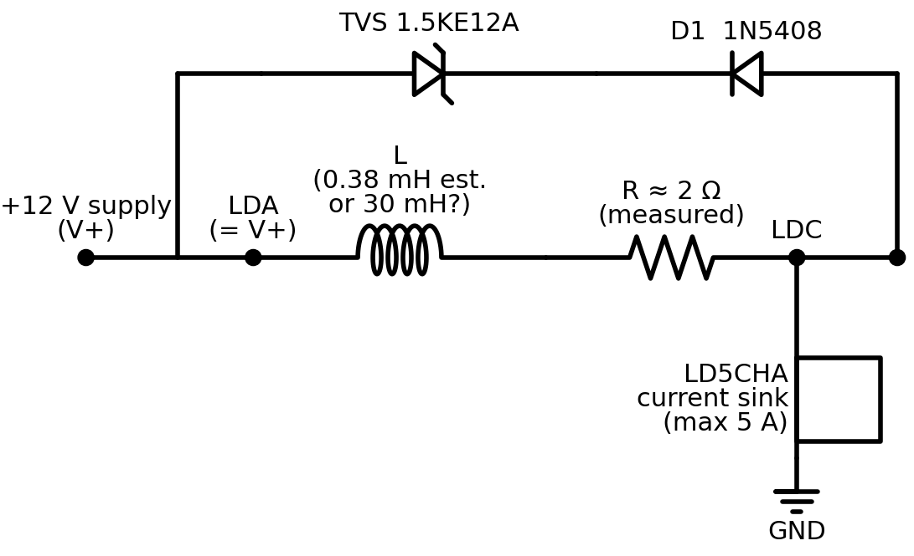

# Preliminary: LD5CHA driving the coil directly

Source: [scripts/draw_direct_drive.py](../scripts/draw_direct_drive.py) (SVG: [direct_drive.svg](direct_drive.svg)).

## Assumptions
- Whole-circuit resistance **R ≈ 2 Ω** (measured; includes cables and contacts, so not the bare coil).
- Inductance **L is not settled**: 0.38 mH (geometric estimate, [coil-estimate.md](coil-estimate.md)) or 30 mH (the figure used in the earlier chat). Measure with an LCR meter.
- Supply V+ = 12 V, target current 3 A. LDA is tied to V+ inside the driver, so the driver is a low-side sink.

## Clamp
D1 (1N5408) and the TVS (1.5KE12A) are in series across the coil, cathode to cathode, mounted at the coil terminals.
- Normal operation: D1 is reverse-biased, so the clamp carries no current and doesn't disturb the measured coil current.
- Turn-off: the coil pushes LDC above V+, and current flows LDC → D1 → TVS (in breakdown) → LDA → coil.

## Operating point at 3 A, V+ = 12 V
| Quantity | Value |
|---|---|
| Coil/circuit drop I·R | 6 V |
| Driver headroom | 12 − 2 (compliance) − 6 = 4 V margin |
| Driver dissipation (V+ − I·R)·I | ≈ 18 W (limit 25 W with no airflow, so use a heatsink and airflow) |
| Load dissipation I²R | 18 W (in the 2 Ω, wherever it physically sits) |
| Peak LDC at turn-off | ≈ 12 + 14.7 (TVS max Vbr) + 1 ≈ 28 V |
| Ramp-down time, L = 30 mH | ≈ (L/R)·ln(1 + I·R/Vz) = 15 ms × ln(1 + 6/14.7) ≈ 5 ms |
| Ramp-down time, L = 0.38 mH | ≈ 0.19 ms × 0.34 ≈ 0.07 ms |

## Open items
- The maximum voltage allowed on LDC isn't known (28 V peak is close to the 30 V supply limit). Ask Wavelength.
- Check LDC with a scope for oscillation at first power-up (inductive load, driver compensated for a diode load).
- If L is really 30 mH and a 1 ms ramp-down is needed, this clamp is too slow. See the series-MOSFET design in the earlier chat.
- Find the missing ~1.8 Ω if the bare coil should be about 0.19 Ω.
