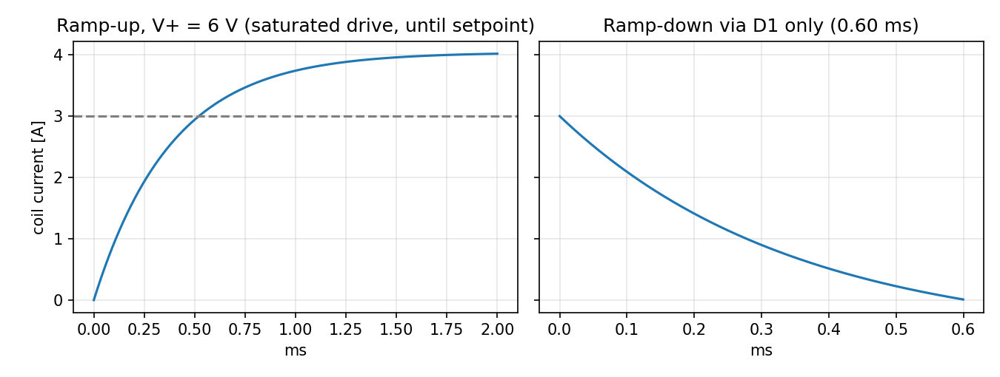

# Preliminary: LD5CHA driving the coil directly (rev 2)

Sources: [draw_direct_drive.py](../scripts/draw_direct_drive.py) (SVG: [direct_drive.svg](direct_drive.svg)), [sim_direct_drive.py](../scripts/sim_direct_drive.py), [sim output](direct_drive_sim_output.txt), 

## Assumptions (rev 2)
- Coil **L = 0.38 mH**, coil R = 0.19 Ω ([coil-estimate.md](coil-estimate.md)).
- Cables and connections add about **0.8 Ω**, so the total is **R ≈ 1.0 Ω** (the sim uses 0.99 Ω), τ = L/R ≈ 0.38 ms.
- Target **3 A**. LDA is tied to V+ inside the driver, so the driver is a low-side sink.
- **LDC voltage limit set to 12 V** for driver safety (a design choice, since the datasheet value is unknown).

## LDC voltage budget
In normal operation LDC sits between about 2 V (compliance floor) and V+, which is the driver's designed range. The only excursion above V+ happens at turn-off, when the coil pushes LDC up until the clamp conducts.

| Range | Value | Comment |
|---|---|---|
| Normal operation | 2 V … V+ | Designed range for this driver |
| Peak with D1 only | V+ + Vf ≈ V+ + 1.0 V (1N5408 at 3 A) | Sub-ms pulse, 1 V above the rail |
| Your limit | 12 V | Allows V+ up to about 10–11 V |
| Beyond that | Unknown | The datasheet may allow up to the 30 V supply limit, but this is unconfirmed. Ask Wavelength. |

The earlier TVS (1.5KE12A) is **dropped**. It would raise LDC to V+ + 14 V or more, which breaks the 12 V limit. Even with a 6.8 V TVS, LDC would reach about V+ + 8 V. D1 alone keeps the excursion to 1 V.

## Result (simulated, constant-drop D1 model; see the script)
- **Ramp-down 3 A → 0 through D1:** about **0.60 ms**, which already meets the "≈ 1 ms" goal.
- **Ramp-up to 3 A with the driver saturated:**

| V+ | Max current | Ramp-up to 3 A | Driver dissipation at 3 A | LDC peak at turn-off |
|---|---|---|---|---|
| 5 V | 3.03 A (no margin) | 1.77 ms | 6.1 W | 6.0 V |
| **6 V (chosen)** | 4.04 A | 0.52 ms | 9.1 W | 7.0 V |
| 8 V | 6.06 A | 0.26 ms | 15.1 W | 9.0 V |
| 10 V | 8.08 A | 0.18 ms | 21.1 W (near the 25 W limit) | 11.0 V |

**Recommendation: V+ = 6 V.** It has 1 V of headroom for a hot coil (R rises about 0.04 Ω), LDC stays at 7 V or below, and the driver dissipates only about 9 W.

## Parts
- D1: 1N5408 (3 A, 1000 V) or any rectifier rated at least 5 A. Mount it at the coil terminals. A silicon diode is better than a Schottky, whose leakage would be read as load current.
- No TVS, resistor or capacitor is needed for the 0.6 ms ramp-down.

## Open items
- Confirm L (0.38 mH) with an LCR meter. If it is much larger, the ramp-down gets proportionally slower.
- The 1N5408 forward-drop model is approximate (0.7 V + 0.1 V/A). Check with the datasheet curve.
- Check LDC with a scope at the first power-up for oscillation (an inductive load, with the driver compensated for diode loads).
- Total R of about 1 Ω assumes the cables account for the extra 0.8 Ω. The earlier whole-circuit reading was about 2 Ω, so re-measure.
- Ask Wavelength for the maximum voltage allowed on LDC and whether a brief excursion above V+ is acceptable.
