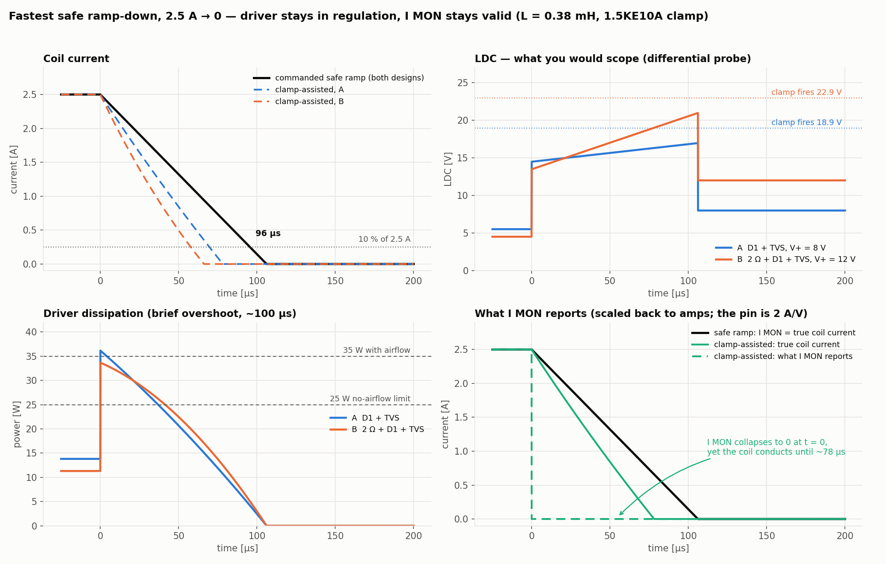

# A vs B: fastest safe ramp-down

Script: [sim_fastest_safe_ramp.py](../scripts/sim_fastest_safe_ramp.py) · [output](fastest_safe_ramp_output.txt).
Schematics: [A — D1 + TVS](alt-design-d1-zener.md) · [B — series 2 Ω + D1 + TVS](chosen-design.md). Background: [imon-and-tvs.md](imon-and-tvs.md).

## What "fastest safe" means here

Safe = **the driver stays in regulation for the whole ramp**, so the clamp never conducts and I MON keeps reading the true coil current. That caps the inductive overshoot at the TVS standoff:

> ΔV = V_wm + V_f(leakage) = 8.55 + 0.4 = **8.95 V** (1.5KE10A)
> commanded linear ramp T = L·I₀/ΔV = **106 µs** → **96 µs to 10 %**

Both designs use the same 1.5KE10A, chosen in [imon-and-tvs.md](imon-and-tvs.md) because the 1.5KE6.8A leaks up to 1000 µA.

## The comparison

| | **A — D1 + TVS**, V+ = 8 V | **B — 2 Ω + D1 + TVS**, V+ = 12 V |
|---|---|---|
| Parts added | 2 leaded | 3, one a 50 W heatsinked resistor |
| Steady LDC at 2.5 A | 5.53 V | 4.52 V |
| Compliance margin | 3.53 V | 2.52 V |
| Driver dissipation | 13.8 W (55 % of 25 W) | 11.3 W (45 %) |
| Heat in Rs | — | 12.5 W |
| **Total heat in the system** | **20.0 W** | **30.0 W** |
| **Fastest safe ramp-down** | **96 µs** | **96 µs** |
| Peak LDC during that ramp | **17.0 V** | 21.0 V |
| Clamp fires at | 18.9 V | 22.9 V |
| Peak driver power during ramp | 36 W for ~100 µs | 34 W |
| **Ramp-up 0 → 2.5 A** | 204 µs | **175 µs** |
| Clamp-assisted decay (I MON blind) | 70 µs | 58 µs |

### Why the ramp-down speed is identical

For a commanded linear ramp, peak LDC = V+ + L·I₀/T. The peak occurs at the **end**, where i → 0 and the i·R term has vanished — **so R does not appear, and the series resistor buys nothing for ramp-down.** Its only speed benefit is in clamp-assisted decay (58 vs 70 µs), which you are not using if I MON has to stay valid.

### What B actually costs and buys

B drops 7.5 V across the load instead of 2.5 V, which forces V+ up to 12 V to keep compliance. That higher rail is then **added to every LDC excursion** — hence 21.0 V instead of 17.0 V for the same ramp. In exchange it ramps up 29 µs faster (175 vs 204 µs) and moves 2.5 W out of the driver, at the price of 10 W more total heat and a 50 W power resistor to mount.

**Recommendation: design A.** Same ramp-down, 4 V less stress on an LDC pin with no published rating, 10 W less heat, and one fewer part to mount. Choose B only if that 29 µs of ramp-up is worth it.

## What you would observe (design A)

**Coil current** — a clean straight line, 2.5 A → 0 over 106 µs, reaching 10 % at 96 µs.

**LDC (differential probe)** — three distinct features:
1. A **step up of ~9 V** at t = 0, from 5.53 V steady to 14.5 V, as the driver starts the ramp.
2. A **linear rise to 17.0 V** over the ramp, because LDC = V+ − i·R + ΔV and the i·R term shrinks as the current falls.
3. A **step down to V+ = 8 V** when the ramp ends and di/dt goes to zero.

The corners will be rounded in reality — the driver's loop has ~0.8 µs rise/fall, and may overshoot or ring slightly at each step.

**I MON** — tracks the coil current exactly, 1.25 V → 0 V (2 A/V).

**Driver dissipation** — jumps to 36 W at t = 0, then falls to zero over the ramp. It exceeds the 25 W rating for roughly 60 µs; at that timescale the thermal mass absorbs it, and the average over the ramp is 19 W.

## The bench test that matters

**Push the ramp faster until the clamp fires, then back off.** You will see it unambiguously on two traces at once:

- **LDC flat-tops** at 18.9 V instead of continuing to rise.
- **I MON collapses to ~0** while the current is still flowing.

That pair is the signature of the clamp taking over (bottom-right panel). The ramp time at which it first appears is your real limit, including all the tolerances the model does not know about. Set your working ramp ~20 % slower than that.

## Bring-up

1. Set the LIM trimpot to ~2.7 A before connecting the coil.
2. Generate the ramp on MOD INPUT (1 A/V in CC mode): 2.5 V → 0 V linear over 106 µs. Keep the pin within −2 V to +5 V.
3. Start at 0.5 A with a slow ramp. Scope LDC with a **differential or isolated probe** — LDC is live, and a scope ground clip shorts it.
4. Confirm steady LDC ≈ 5.5 V at 2.5 A, and the three-feature waveform above.
5. Shorten the ramp stepwise, watching for the flat-top/collapse signature.
6. Check driver case temperature after a few minutes at 2.5 A.

## Caveats

- L = 0.38 mH and R = 0.99 Ω are confirmed; everything else here is modelled.
- The model assumes the driver's loop tracks the commanded ramp exactly. The square corners are idealised.
- TVS standoff and breakdown carry ±5 % tolerance, so the clamp threshold and the usable ΔV shift with it. The bench test above supersedes the calculated number.
- In design B, a wirewound Rs adds a few µH — under 1 % of 0.38 mH, but use a non-inductive type if convenient.
- The LD5CHA datasheet still gives **no maximum LDC voltage**. 17 V and 21 V are both judgement calls below the 28 V maximum compliance figure.
