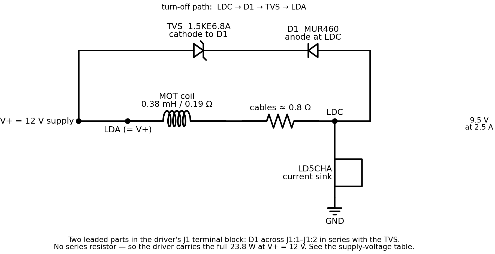
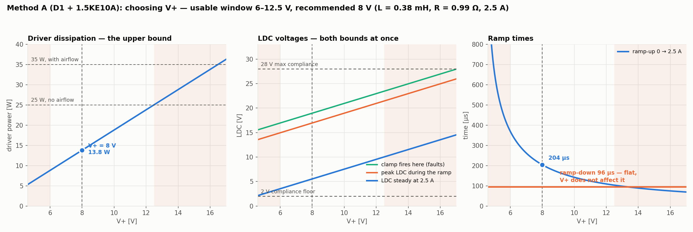
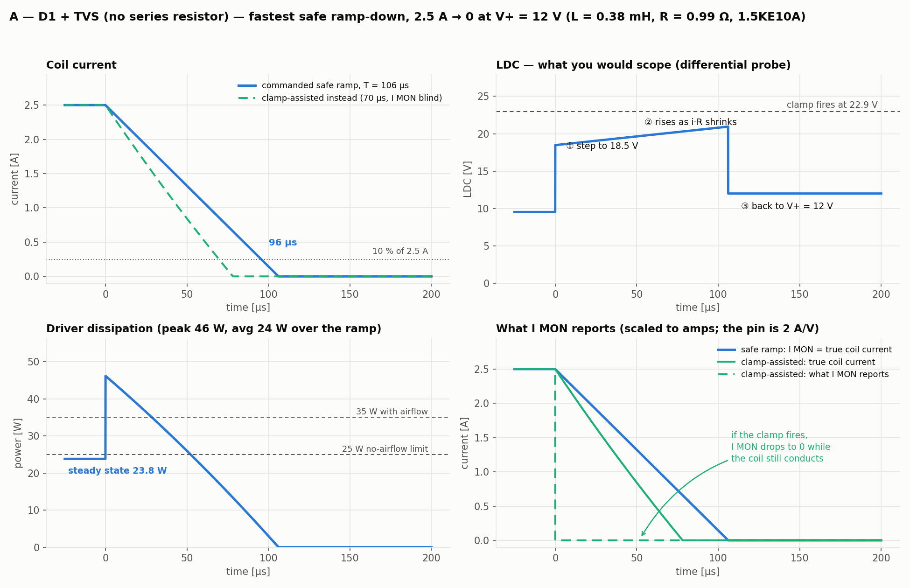

# Method A — D1 + TVS, no series resistor

Schematic source: [draw_d1_tvs_clamp.py](../scripts/draw_d1_tvs_clamp.py) · [SVG](../figures/schematic-d1-tvs-clamp.svg) · [numbers](../outputs/d1-tvs-clamp.txt)
Simulation source: [sim_fastest_safe_ramp.py](../scripts/sim_fastest_safe_ramp.py) · [output](../outputs/fastest-safe-ramp.txt)
Background on the clamp and the monitor: [clamp-sizing-and-imon.md](reference/clamp-sizing-and-imon.md). The other candidate: [method B](alternatives/series-resistor.md).

**Load (confirmed):** L = 0.38 mH, coil R = 0.19 Ω, cables ≈ 0.8 Ω → R_loop = **0.99 Ω**, τ = **384 µs**. I = 2.5 A.

## The circuit

Two leaded parts in the driver's J1 terminal block: **D1 in series with a TVS, cathode to cathode, across J1:2 (LDA) and J1:1 (LDC)**. Nothing else changes.

- **Normal operation:** LDA sits above LDC, so D1 is reverse-biased and the clamp is invisible to the circuit.
- **Turn-off:** the coil pushes LDC up; if it ever reaches the clamp, current freewheels LDC → D1 → TVS → LDA.

In the intended operating mode the clamp **never conducts** — it is fault protection only, and the ramp is done by the setpoint so that I MON stays valid.

## Choosing V+

Source: [supply_voltage_window.py](../scripts/supply_voltage_window.py) · [output](../outputs/supply-voltage-window.txt)

Without a series resistor the load only drops 2.48 V at 2.5 A, so the driver absorbs everything else. Three constraints bracket the supply:

| V+ | LDC steady | Margin | Driver P | % of 25 W | Ramp-up | **Ramp-down** | LDC peak | Clamp fires | Verdict |
|---|---|---|---|---|---|---|---|---|---|
| 5 V | 2.52 V | 0.52 V | 6.3 W | 25 % | 669 µs | 96 µs | 14.0 V | 15.9 V | no compliance margin |
| 6 V | 3.52 V | 1.52 V | 8.8 W | 35 % | 370 µs | 96 µs | 15.0 V | 16.9 V | ok, slow ramp-up |
| 7 V | 4.53 V | 2.53 V | 11.3 W | 45 % | 262 µs | 96 µs | 16.0 V | 17.9 V | ok |
| 8 V | 5.53 V | 3.53 V | 13.8 W | 55 % | 204 µs | 96 µs | 17.0 V | 18.9 V | most thermal margin |
| 9 V | 6.53 V | 4.53 V | 16.3 W | 65 % | 167 µs | 96 µs | 18.0 V | 19.9 V | ok |
| 10 V | 7.53 V | 5.53 V | 18.8 W | 75 % | 142 µs | 96 µs | 19.0 V | 20.9 V | ok |
| **12 V** | **9.53 V** | **7.53 V** | **23.8 W** | **95 %** | **109 µs** | **96 µs** | **21.0 V** | **22.9 V** | **chosen — add airflow** |
| 14 V | 11.53 V | 9.53 V | 28.8 W | 115 % | 89 µs | 96 µs | 23.0 V | 24.9 V | needs forced airflow |
| 16 V | 13.53 V | 11.53 V | 33.8 W | 135 % | 75 µs | 96 µs | 25.0 V | 26.9 V | needs forced airflow |

**Ramp-down is 96 µs at every supply voltage.** It is set by the TVS standoff and L·I₀, not by the rail — the right-hand panel of the figure makes this explicit. V+ buys ramp-**up** speed only, and pays for it in heat and LDC stress.

### The three bounds

- **Lower, compliance:** LDC must stay above 2 V. The hard floor is V+ ≥ 4.47 V, but at 5 V there is only 0.5 V of margin — a warm coil or a sagging supply pushes the driver out of regulation. Keep V+ ≥ 6 V.
- **Upper, heat:** the driver hits 25 W at V+ = 12.5 V and 35 W at 16.5 V. Without forced air, stay below ~12 V; **with** 5.5 CFM of air the wall moves out to 16.5 V.
- **Upper, LDC stress:** every LDC excursion is stacked on V+. At 16 V the clamp would fire at 26.9 V, within sight of the 28 V maximum compliance figure.

### Chosen: V+ = 12 V

12 V is the top of the usable window. It buys the **fastest ramp-up (109 µs instead of 204 µs at 8 V)** and plenty of compliance margin, at the cost of thermal headroom:

- **23.8 W steady is 95 % of the 25 W no-airflow rating.** A heatsink is necessary but not sufficient — 25 W is the *package* limit, and it is specified at 25 °C ambient. **Add forced air.** The datasheet's 35 W figure needs only **5.5 CFM**, which any small 40 mm fan exceeds; that drops you to 68 % and makes 12 V comfortable rather than marginal.
- **Peak LDC 21.0 V, clamp at 22.9 V.** The 1.9 V gap between the working peak and the clamp is unchanged from 8 V — both ride on V+ together. What *has* shrunk is the headroom above the clamp: 5.1 V to the 28 V compliance figure, instead of 9.1 V.
- **A 15 V TVS is no longer an option at this rail.** 1.5KE15A would put the clamp at 27.9 V, essentially on top of the 28 V figure. At 12 V the TVS choice is limited to 6.8 V or 10 V. See the [order list](order-list.md).
- **Set LIM first.** At 12 V the load would let the driver push roughly 10 A — twice its 5 A maximum. The LIM trimpot is the only thing standing in the way.

If the case runs hot and you cannot add a fan, 10 V (75 %, 142 µs ramp-up) gives back real margin for little speed.

## Fastest safe ramp-down

"Safe" means the driver stays in regulation the whole way down, so the clamp never conducts and **I MON keeps reading the true coil current**. That caps the inductive overshoot at the TVS standoff:

> ΔV = V_wm + V_f = 8.55 + 0.4 = **8.95 V** → commanded linear ramp T = L·I₀/ΔV = **106 µs** → **96 µs to 10 %**

| Quantity | Value |
|---|---|
| Ramp-down to 10 % | **96 µs**, I MON valid throughout |
| LDC: steady → step → peak → settle | 9.53 V → 18.5 V → **21.0 V** → 12 V |
| Clamp fires at | 22.9 V (faults only) |
| Driver power during the ramp | peak 46 W, average 24 W, lasting ~106 µs |
| Ramp-up 0 → 2.5 A | 109 µs |
| If you let the clamp do it instead | 70 µs, but I MON goes blind |

### What you would observe

**Coil current** — a clean straight line, 2.5 A → 0 over 106 µs, crossing 10 % at 96 µs.

**LDC (differential probe)** — three features:
1. a **step up of ~9 V** at t = 0, from 9.53 V to 18.5 V, as the ramp starts;
2. a **linear rise to 21.0 V**, because LDC = V+ − i·R + ΔV and the i·R term shrinks as current falls;
3. a **step back down to V+ = 12 V** when the ramp ends and di/dt goes to zero.

**I MON** — tracks the coil exactly, 1.25 V → 0 V at 2 A/V.

**Driver dissipation** — jumps from the 23.8 W steady state to 46 W, then decays to zero over the ramp. It exceeds 35 W for about 28 µs and 25 W for about 52 µs; at 24 W average over 106 µs that is only **2.5 mJ**, which the package absorbs without noticing. The transient is not the thermal problem at this rail — **the 23.8 W steady state is.**

The square corners are idealised. The driver's loop is ~0.8 µs, so expect rounding and possibly a little ringing at each step.

## Parts

| Ref | Part | Why |
|---|---|---|
| D1 | MUR460 (4 A, 600 V ultrafast) — or 1N5408 (3 A, 1000 V) | Silicon, **not Schottky**: Schottky leakage runs to tens of mA when hot, and it flows in parallel with the coil, so the coil would get less current than the driver regulates. The reverse voltage across the D1 + TVS string is only I₀·R ≈ 2.5 V, so the 600 V rating is wild overkill — you are buying the current rating and the soft turn-off, not the volts |
| TVS | **1.5KE10A**, unidirectional, axial | 8.55 V standoff sets the usable ramp; breakdown at 10 V gives a flat clamp at 2.5 A. See [clamp-sizing-and-imon.md](reference/clamp-sizing-and-imon.md) for why not the 6.8 V part |
| — | Barrier terminal block | Both parts sit in it, cathode to cathode, across J1:1–J1:2 |

## Mounting — an advantage this design has

Peak LDC is the same wherever the clamp sits; only the freewheel loop resistance changes:

| Clamp position | Loop R | D1 alone | With the TVS |
|---|---|---|---|
| Driver terminals (cables in the loop) | 0.99 Ω | 403 µs | 93 µs |
| Coil terminals (cables outside) | 0.19 Ω | 713 µs | 105 µs |

With a TVS fitted, mounting at the **coil** costs only ~12 µs in the fault case and means a broken cable on the driver side still leaves the coil a freewheel path. [Method B](alternatives/series-resistor.md) cannot do this, because its clamp has to span the series resistor.

## Bring-up

1. **Set the LIM trimpot to ~2.7 A before connecting the coil.** At V+ = 12 V this load would accept about 10 A, double the driver's 5 A maximum, so LIM is the only limit that applies. Fit the heatsink and point a small fan at it in the same step.
2. Drive MOD INPUT (1 A/V in CC mode) with a linear 2.5 V → 0 V ramp over 106 µs. Keep the pin within −2 V to +5 V.
3. Start at 0.5 A with a slow ramp. Scope LDC with a **differential or isolated probe** — LDC is live, and a scope ground clip shorts it to ground.
4. Confirm steady LDC ≈ 9.5 V at 2.5 A and the three-feature waveform above.
5. **Shorten the ramp until the clamp fires**, then back off ~20 %. The signature is unmistakable on two traces at once: LDC flat-tops at 22.9 V instead of continuing to rise, and I MON collapses to ~0 while current still flows. That measured threshold beats the calculated 106 µs, because it includes tolerances the model does not know.
6. **Check driver case temperature after a few minutes at 2.5 A** — this matters more at 12 V than at any other step. 23.8 W continuous is 95 % of the no-airflow rating. If the case is too hot to hold, either add airflow or drop V+ to 10 V.

## Caveats

- L and R are confirmed; everything downstream is modelled, not measured.
- TVS standoff and breakdown carry ±5 % tolerance, so the usable ΔV and the clamp threshold shift with it — hence step 5 above.
- D1's forward drop is taken as 0.4 V at leakage currents and 0.95 V at 2.5 A.
- The LD5CHA datasheet gives **no maximum LDC voltage**; 21 V peak is a judgement call below the 28 V maximum compliance figure.
- 23.8 W at V+ = 12 V leaves 5 % margin on a rating specified at 25 °C ambient with no airflow. Treat forced air as part of the design, not an optional extra.
