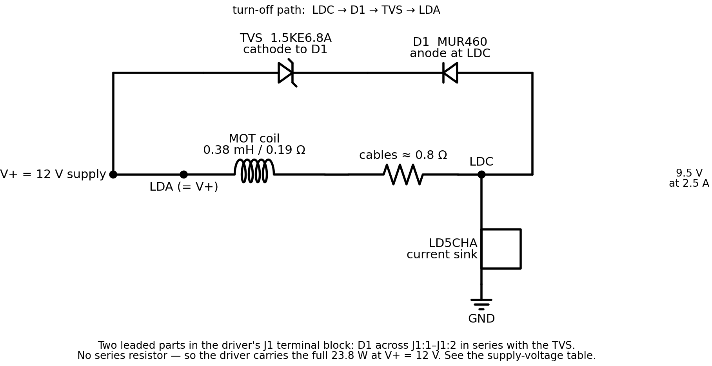
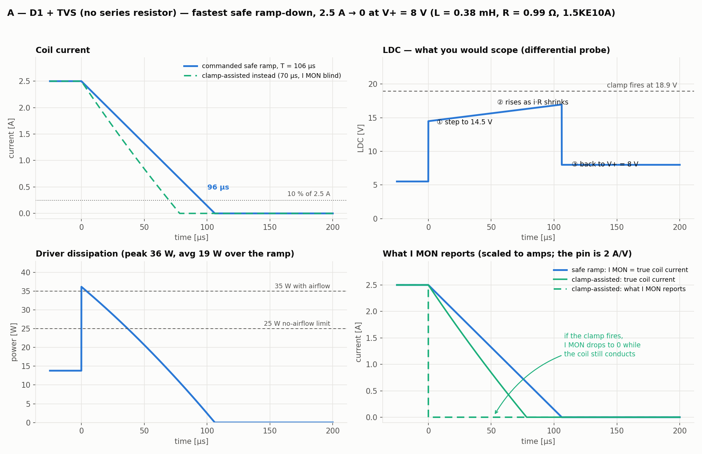

# Method A — D1 + TVS, no series resistor

Schematic source: [draw_d1_zener.py](../scripts/draw_d1_zener.py) · [SVG](d1_zener.svg) · [numbers](d1_zener_output.txt)
Simulation source: [sim_fastest_safe_ramp.py](../scripts/sim_fastest_safe_ramp.py) · [output](fastest_safe_ramp_output.txt)
Background on the clamp and the monitor: [imon-and-tvs.md](imon-and-tvs.md). The other candidate: [method B](method-b-series-resistor.md).

**Load (confirmed):** L = 0.38 mH, coil R = 0.19 Ω, cables ≈ 0.8 Ω → R_loop = **0.99 Ω**, τ = **384 µs**. I = 2.5 A.

## The circuit

Two leaded parts in the driver's J1 terminal block: **D1 in series with a TVS, cathode to cathode, across J1:2 (LDA) and J1:1 (LDC)**. Nothing else changes.

- **Normal operation:** LDA sits above LDC, so D1 is reverse-biased and the clamp is invisible to the circuit.
- **Turn-off:** the coil pushes LDC up; if it ever reaches the clamp, current freewheels LDC → D1 → TVS → LDA.

In the intended operating mode the clamp **never conducts** — it is fault protection only, and the ramp is done by the setpoint so that I MON stays valid.

## Supply voltage

Without a series resistor the load only drops 2.48 V at 2.5 A, so the driver absorbs the rest:

| V+ | LDC steady | Driver dissipation | % of the 25 W no-airflow limit | Ramp-up 0 → 2.5 A |
|---|---|---|---|---|
| 6 V | 3.52 V | 8.8 W | 35 % | 370 µs |
| 7 V | 4.53 V | 11.3 W | 45 % | 262 µs |
| **8 V** | **5.53 V** | **13.8 W** | **55 %** | **204 µs** |
| 10 V | 7.53 V | 18.8 W | 75 % | 142 µs |
| 12 V | 9.53 V | 23.8 W | 95 % | 109 µs |

**V+ = 8 V is the recommended point.** It keeps the driver at 55 % of its rating with margin for a warm room, leaves 3.5 V above the 2 V compliance floor, and keeps peak LDC low because every LDC excursion is stacked on V+. Running at 12 V puts the driver at 95 % with no margin.

## Fastest safe ramp-down

"Safe" means the driver stays in regulation the whole way down, so the clamp never conducts and **I MON keeps reading the true coil current**. That caps the inductive overshoot at the TVS standoff:

> ΔV = V_wm + V_f = 8.55 + 0.4 = **8.95 V** → commanded linear ramp T = L·I₀/ΔV = **106 µs** → **96 µs to 10 %**

| Quantity | Value |
|---|---|
| Ramp-down to 10 % | **96 µs**, I MON valid throughout |
| LDC: steady → step → peak → settle | 5.53 V → 14.5 V → **17.0 V** → 8 V |
| Clamp fires at | 18.9 V (faults only) |
| Driver power during the ramp | peak 36 W, average 19 W, lasting ~106 µs |
| Ramp-up 0 → 2.5 A | 204 µs |
| If you let the clamp do it instead | 70 µs, but I MON goes blind |

### What you would observe

**Coil current** — a clean straight line, 2.5 A → 0 over 106 µs, crossing 10 % at 96 µs.

**LDC (differential probe)** — three features:
1. a **step up of ~9 V** at t = 0, from 5.53 V to 14.5 V, as the ramp starts;
2. a **linear rise to 17.0 V**, because LDC = V+ − i·R + ΔV and the i·R term shrinks as current falls;
3. a **step back down to V+ = 8 V** when the ramp ends and di/dt goes to zero.

**I MON** — tracks the coil exactly, 1.25 V → 0 V at 2 A/V.

**Driver dissipation** — jumps to 36 W, decays to zero over the ramp. Above 25 W for roughly 60 µs, which the thermal mass absorbs; the average over the ramp is 19 W.

The square corners are idealised. The driver's loop is ~0.8 µs, so expect rounding and possibly a little ringing at each step.

## Parts

| Ref | Part | Why |
|---|---|---|
| D1 | MUR460 (4 A, 600 V ultrafast) — or 1N5408 (3 A, 1000 V) | Silicon, **not Schottky**: Schottky leakage runs to tens of mA when hot, and it flows in parallel with the coil, so the coil would get less current than the driver regulates. Only sees ~7 V reverse here |
| TVS | **1.5KE10A**, unidirectional, axial | 8.55 V standoff sets the usable ramp; breakdown at 10 V gives a flat clamp at 2.5 A. See [imon-and-tvs.md](imon-and-tvs.md) for why not the 6.8 V part |
| — | Barrier terminal block | Both parts sit in it, cathode to cathode, across J1:1–J1:2 |

## Mounting — an advantage this design has

Peak LDC is the same wherever the clamp sits; only the freewheel loop resistance changes:

| Clamp position | Loop R | D1 alone | With the TVS |
|---|---|---|---|
| Driver terminals (cables in the loop) | 0.99 Ω | 403 µs | 93 µs |
| Coil terminals (cables outside) | 0.19 Ω | 713 µs | 105 µs |

With a TVS fitted, mounting at the **coil** costs only ~12 µs in the fault case and means a broken cable on the driver side still leaves the coil a freewheel path. [Method B](method-b-series-resistor.md) cannot do this, because its clamp has to span the series resistor.

## Bring-up

1. Set the LIM trimpot to ~2.7 A before connecting the coil. At V+ = 8 V the driver can reach 6.1 A into this load.
2. Drive MOD INPUT (1 A/V in CC mode) with a linear 2.5 V → 0 V ramp over 106 µs. Keep the pin within −2 V to +5 V.
3. Start at 0.5 A with a slow ramp. Scope LDC with a **differential or isolated probe** — LDC is live, and a scope ground clip shorts it to ground.
4. Confirm steady LDC ≈ 5.5 V at 2.5 A and the three-feature waveform above.
5. **Shorten the ramp until the clamp fires**, then back off ~20 %. The signature is unmistakable on two traces at once: LDC flat-tops at 18.9 V instead of continuing to rise, and I MON collapses to ~0 while current still flows. That measured threshold beats the calculated 106 µs, because it includes tolerances the model does not know.
6. Check driver case temperature after a few minutes at 2.5 A.

## Caveats

- L and R are confirmed; everything downstream is modelled, not measured.
- TVS standoff and breakdown carry ±5 % tolerance, so the usable ΔV and the clamp threshold shift with it — hence step 5 above.
- D1's forward drop is taken as 0.4 V at leakage currents and 0.95 V at 2.5 A.
- The LD5CHA datasheet gives **no maximum LDC voltage**; 17 V peak is a judgement call below the 28 V maximum compliance figure.
