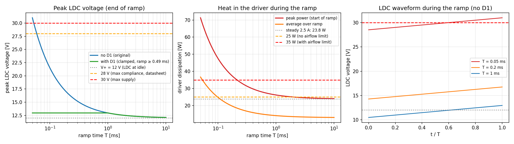

# Ramp-down 2.5 A → 0 versus timescale (original config, V+ = 12 V)

Script: [ramp_down_analysis.py](../scripts/ramp_down_analysis.py). Table file: [ramp_down_table.md](ramp_down_table.md).

## Model
The setpoint ramps linearly (MOD INPUT, 1 A/V, so 2.5 V → 0 V in time T) and the driver stays in regulation, forcing i(t) = I0·(1 − t/T).
- LDC(t) = V+ − i·R − L·di/dt = V+ − i·R + L·I0/T. The last term is an overshoot above V+ that is largest at the end of the ramp, where i → 0.
- Driver heat P(t) = LDC(t)·i(t).
- Values: L = 0.38 mH, R = 0.99 Ω (coil plus cables), V+ = 12 V, I0 = 2.5 A.
- The driver's own bandwidth (about 1 MHz, rise or fall time about 0.8 µs) is far faster than these ramps, so it is not the limit.

## Results
| Ramp time T | di/dt | Peak LDC, no D1 | Peak LDC with D1 | Driver peak P | Driver avg P over ramp | Driver energy over ramp | Verdict (no D1) |
|---|---|---|---|---|---|---|---|
| 0.05 ms | 50000 A/s | 31.0 V | 12.9 V | 71 W | 36.7 W | 1.83 mJ | **avalanche risk** (above 30 V) |
| 0.1 ms | 25000 A/s | 21.5 V | 12.9 V | 48 W | 24.8 W | 2.48 mJ | high, unverified |
| 0.2 ms | 12500 A/s | 16.8 V | 12.9 V | 36 W | 18.9 W | 3.77 mJ | moderate |
| 0.5 ms | 5000 A/s | 13.9 V | 12.9 V | 29 W | 15.3 W | 7.66 mJ | benign (within about 2 V of V+) |
| 1 ms | 2500 A/s | 12.9 V | 12.9 V | 26 W | 14.1 W | 14.12 mJ | benign (within about 2 V of V+) |
| 2 ms | 1250 A/s | 12.5 V | 12.5 V | 25 W | 13.5 W | 27.06 mJ | benign (within about 2 V of V+) |
| 5 ms | 500 A/s | 12.2 V | 12.2 V | 24 W | 13.2 W | 65.87 mJ | benign (within about 2 V of V+) |
| 10 ms | 250 A/s | 12.1 V | 12.1 V | 24 W | 13.1 W | 130.56 mJ | benign (within about 2 V of V+) |

Steady 2.5 A dissipation: 23.8 W. Coil + cable energy ½·L·I0² = 1.19 mJ (≈ 50 µs of steady-state heat, independent of T).
With D1 the current cannot fall faster than natural decay, about 0.49 ms, so commanded ramps shorter than that are overridden.

## What it means
**Peak voltage is the real consequence.** It is V+ + L·I0/T, so it grows as 1/T:
- **T ≥ 0.5 ms:** the overshoot is under 2 V above the 12 V rail. This is the same level LDC sits at when the coil is idle, so the driver sees nothing unusual.
- **T = 0.2 ms:** about 17 V, moderate. LDC stays below the 28 V maximum compliance, but the datasheet gives no LDC rating.
- **T = 0.1 ms:** about 21 V. This is unverified territory.
- **T = 0.05 ms:** about 31 V, which is above the 30 V supply limit and the 28 V compliance limit. Avalanche risk.
- **T → 0 (abrupt interruption, such as enable off, a fault, 5 V logic loss or unplugging):** the transistor stops conducting and LDC flies up to its breakdown. For example, 2.5 A in 10 µs would give about 95 V. The stored energy is only 1.2 mJ, but the voltage is uncontrolled.

**Heat is minor.**
- The coil adds only ½·L·I0² = 1.19 mJ to the driver (the same as about 50 µs of steady-state heating), whatever T is.
- Average driver power during the ramp is below the 2.5 A steady value for T ≥ 0.1 ms.
- Peak power (at the start of the ramp) is 71 W at 0.05 ms and 48 W at 0.1 ms. These last microseconds and exceed even the 35 W airflow limit, but the thermal mass of the driver should absorb them. This isn't verified against the SOA calculator.
- For T ≥ 0.5 ms the peak is within a few watts of steady state.
- For repeated ramps, the average dissipation depends on the duty cycle. Steady 2.5 A at 12 V is 23.8 W, close to the 25 W no-airflow limit.

**With D1 (reference):** LDC stays at about 12.9 V for any commanded ramp, but the current cannot fall faster than natural decay through D1, about 0.49 ms. Shorter commands are overridden by D1.

## Recommendation for the bare connection
- Ramp the setpoint over **≥ 0.5 ms** (≤ 2 V overshoot) when working without D1. The 1 ms from the original goal gives about 0.95 V above V+.
- Keep ramps ≥ 0.2 ms at the very least.
- Avoid abrupt interruptions (enable pin, unplugging under current). That is the case D1 is for.

## Caveats
- A model, not a measurement. It assumes the loop tracks the ramp (rise or fall time about 0.8 µs, so it should) and a constant R.
- The datasheet gives no maximum LDC voltage. The 28 V and 30 V lines are reference points taken from the compliance and supply limits, not guarantees.
- Verify on the bench: scope LDC (with a differential or isolated probe, because LDC is a live node, and keep the first runs at 0.5 A) and increase ramp speed step by step.
