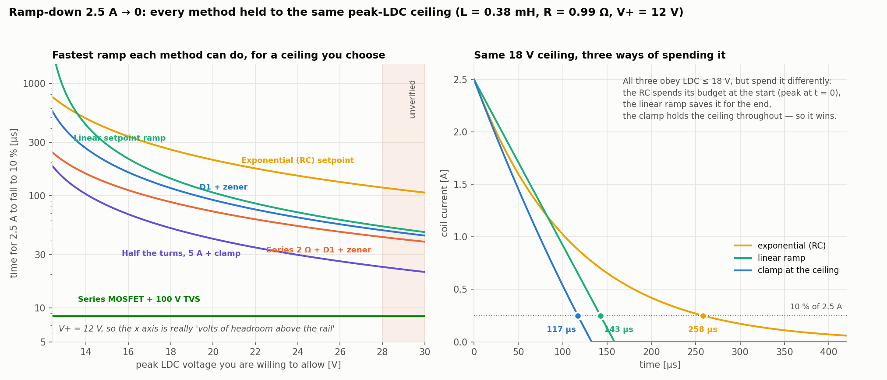

# Ways to speed up the ramp-down, compared at a common limit

Script: [ramp_speed_options.py](../scripts/ramp_speed_options.py).
Load: **L = 0.38 mH, R = 0.99 Ω (confirmed)**, I0 = 2.5 A, V+ = 12 V. All times are 2.5 A → 10 %.

## The common limit

Comparing methods only means something if they are all held to the **same peak LDC voltage**, because that is the one thing that can damage the driver. Quoting a faster time that was bought by pushing LDC higher is not a faster method, it is just a riskier setting.

So the question for every row below is the same: **given a ceiling on peak LDC, how fast can this method go?**

The ceiling is a choice, not a datasheet number — Wavelength publishes no maximum for the LDC pin. The table gives five of them. For reference, LDC already sits at V+ = 12 V whenever the coil is idle, and 28 V is the maximum compliance voltage of the part (at a 30 V supply), so above 28 V is unverified in every sense.

## Why the clamp is the theoretical best

The coil only sheds current when LDC is pushed above V+:

> L·di/dt = V+ − LDC − i·R

To empty the coil as fast as possible under a ceiling LDC ≤ V_max, you want LDC pinned **at** the ceiling for the whole ramp. That is exactly what a constant-voltage clamp (D1 + zener) does. No setpoint shape can beat it; the best they can do is match it.

That is the point of the right-hand plot. All three traces obey the same 18 V ceiling, but the RC spends its voltage budget at the start (its peak is at t = 0, where the current is largest), the linear ramp saves it for the end, and only the clamp holds the ceiling throughout. Hence 117 µs vs 143 µs vs 258 µs for the *same* stress on the driver.

## The comparison

Fastest 2.5 A → 10 % that each method can reach, held to each ceiling:

| Method | LDC ≤ 13 V | ≤ 15 V | ≤ 18 V | ≤ 22 V | ≤ 28 V |
|---|---|---|---|---|---|
| Exponential (RC) setpoint | 629 µs | 400 µs | 258 µs | 175 µs | 118 µs |
| Linear setpoint ramp | 855 µs | 285 µs | 143 µs | 86 µs | 53 µs |
| **D1 + zener — best possible without a switch** | **393 µs** | **200 µs** | **117 µs** | **75 µs** | **49 µs** |
| Series 2 Ω + D1 + zener | 201 µs | 131 µs | 88 µs | 62 µs | 43 µs |
| Half the turns, 5 A + clamp | 141 µs | 82 µs | 52 µs | 35 µs | 23 µs |
| **Series MOSFET + 100 V TVS** | **8 µs** | **8 µs** | **8 µs** | **8 µs** | **8 µs** |

Clamp part needed for each column: the zener drops (ceiling − 12 V − 0.95 V). At a 13 V ceiling that is D1 alone; at 18 V a ~5 V zener; at 28 V a ~15 V TVS.

## Reading the table

- **The MOSFET row is flat.** That is the whole reason the complicated option exists. It is the only method whose speed does not depend on the ceiling, because the FET opens and the 100 V lands on the FET and its TVS while LDC is isolated and falls toward 0. Every other row buys speed by spending LDC headroom; this one does not.
- **Setpoint shaping is free but suboptimal.** At any ceiling, the RC and the linear ramp are slower than the clamp that respects the same ceiling. They also only work while the driver is in regulation, so they do nothing for an uncommanded cut.
- **RC vs linear changes order.** Below about a 13.6 V ceiling the RC wins; above it the linear ramp wins. Neither ever beats the clamp.
- **A series 2 Ω resistor pays twice.** It speeds every clamp case (R_total 2.99 Ω instead of 0.99 Ω) *and* drops driver dissipation from 24 W to about 11 W by moving heat into a resistor you can mount anywhere. It costs 12.5 W in that resistor, and D1 must span the coil **and** the resistor or the resistor is not in the freewheel loop.
- **Rewinding changes the physics.** At fixed ampere-turns, halving N gives L/4 and 2·I, so L·I halves and so does the time, at any ceiling. It costs a rewind and pushes you to 5 A, the LD5CHA's absolute maximum with no margin.

## What limits the MOSFET option

Not the TVS — the **gate driver**. The Si8751 named in the earlier chat is specified around 46 µs turn-off (unverified), which would completely swamp an 8 µs decay. A conventional isolated gate driver with its own floating supply turns off in well under 1 µs. Sequence matters too: open the FET first, then zero the setpoint, so the driver is not left saturated against an open load.

## Things that do not help

- **Raising V+.** Current only falls when LDC rises *above* V+, so a higher rail raises the bar it has to clear. It speeds the ramp *up* (0.14 ms at 12 V vs 0.52 ms at 6 V) and costs dissipation.
- **The ENABLE pin.** Datasheet gives 640 µs disable fall time and a 260 µs turn-off ramp — slower than a setpoint step. It is an interlock, not a speed tool.
- **A capacitor across the coil.** Rings with L rather than damping it, and swings LDC negative.

## The limit that may make all of this moot

If the coil sits near a metal chamber, **eddy currents** in the mounts and walls keep the *field* alive after the *current* is gone — typically 100 µs to a few ms for stainless steel, much faster for a glass cell. Chasing 8 µs of current decay is wasted if the field takes 500 µs to die. Measure the field with a pickup coil or magnetometer before buying a MOSFET.

## Suggested path

1. **Fit D1 now.** At a 13 V ceiling it gives 393 µs, and it is the only thing here that also covers uncommanded interruptions.
2. **Measure the field decay**, not just the current, and decide what speed is actually useful.
3. **If you need faster**, add a zener in series with D1 — two leaded parts, no rework, and it is the best you can do without a switch.
4. **Only go to a series MOSFET** if you have measured that you need sub-50 µs, and budget a fast isolated gate driver.

## Caveats

- L and R are confirmed; everything else here is modelled, not measured on the bench.
- The 1N5408 forward drop is taken as 0.95 V at 2.5 A.
- The datasheet gives **no maximum LDC voltage**. Which column you are allowed to use is an open question.
